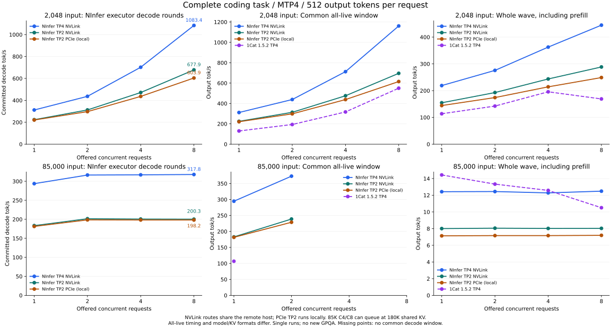

# ninfer-v100xN

[中文](README.zh-CN.md) · [GUI](docs/gui.md) · [TUI](docs/tui.md) · [Docker](docs/docker.md) · [Detailed measurements](docs/performance.md) · [HTTP API](docs/serving.md)

**Compared with the decode implementation before v0.1.0, committed throughput on the same 85K-token
code task increased from 143.46 to 198.10 tok/s — about 38.1% faster.** Both measurements
use two V100 16 GB cards, 180K capacity, TP2/MTP4, INT8 KV, CUDA Graphs and greedy sampling.
The current result enables both experimental long attention and fast decode; output can
change, and the current combination has no GPQA result.
[Current result](docs/performance.md#quasar-v3-mtp4-retained-decode-profile-2026-10-19) · [Previous version](docs/performance.md#quasar-v3-final-long-context-decode-evaluation).

The earlier 220 W host's four-card NVLink optimization measures **283.118 / 283.367 committed wall tok/s** at
85K input with QUASAR/MTP4 and both experimental flags, mean **283.242 ± 0.176**, retaining
**220 W / 1200 MHz** limits. Prefill averages **2334.73 tok/s**, up from 1743 after adapting
1Cat's collective and Split-D mechanisms.
TP4 normal, prefix and actual-85K Graph/eager state checks pass. Split-D and the experimental
profiles can change output; no current-combination GPQA was run. On the separate **300 W** host,
the same 85K/MTP4 fixture now measures **322.138 / 322.218 tok/s** (mean **322.178**), with
**2731.60 tok/s prefill**. This is a new host/power measurement, not an isolated software gain.
These TP4 changes ship in **v0.2.0**, alongside Linux SM70 prebuilt and Docker image archives.
[Method and results](docs/tp4.md).

Fast single-request Qwen3.8-27B inference on **2 × Tesla V100-SXM2 16 GB**, CUDA 12.8 / SM70.
The local cards use PCIe P2P through SXM2-to-PCIe adapters, **without NVLink**.
**QUASAR NVFP4 v3 is the recommended model**, with TP2, INT8 group-64 KV and CUDA Graphs.
Text-only startup loads zero Vision weights. Optional TP2 image/video uses the same artifact;
GUI/TUI provide a Vision ON/OFF switch, off by default.

Maintainer's personal experience: “It feels in the same tier as FP8.”
The authors report GPQA-D 90.91% versus BF16 91.41%, and AIME'26 100% for both.
These are external source-checkpoint results, not our V100 conversion scores or proof of
losslessness. [Sources, independent comparison and limitations](docs/model-quality.md).

## v0.2.1: TP2 / TP4 concurrency and serving fixes

QUASAR NVFP4 / MTP4 now uses packed batch projections, direct packet publication and fused
sum/norm handoff on TP2 and TP4. Complete **2K coding chats**, 512 output tokens per request:

| Route | C1 | C2 | C4 | C8 |
|---|---:|---:|---:|---:|
| 4 × V100 16 GB, NVLink TP4 | 312.1 | 436.6 | 702.0 | **1083.4** |
| 2 × V100 16 GB, NVLink TP2 | 223.5 | 312.4 | 471.4 | **677.9** |
| 2 × V100 16 GB, PCIe P2P without NVLink | 220.8 | 297.2 | 436.0 | **603.9** |

These are total committed decode tok/s from executor rounds, excluding prefill, with Graphs,
greedy optimized-head MTP4 and both experimental profiles. C8 draft acceptance is **74.4%**
for TP4 and **76.4%** for both TP2 routes. The two TP2 hosts differ in more than NVLink.
The new short prompt retains its complete task and assistant prefix. Earlier **493.1 / 554.0**
short-input results used a truncated raw prefix and remain separate diagnostics; changing the
prompt is not a software speedup.

The **85K C1/C2/C4/C8 matrix** reports actual batch and whole-wave latency as well as pure
decode. At 180K shared KV, only two 85K requests fit together, so offered C8 is not eight
simultaneous decode streams. C8 reaches **317.8 / 200.3 / 198.2 tok/s** for TP4 NVLink,
TP2 NVLink and local PCIe TP2, respectively, with mean actual batches of about **1.23**.
The same-host control is now **1Cat 1.5.2 / QUASAR NVFP4 / MTP4**, with all eight
2K/85K × C1/C2/C4/C8 cases measured. It uses FP16 activations / E4M3 KV; its HTTP
token-ID windows are reported separately from NInfer's BF16 / INT8-G64 executor timing.
These are speed references with different numerical profiles, not equal-quality comparisons.
For 2K/C8, the common decode windows measure **1160.9 tok/s** for NInfer TP4's sampled
executor window and **549.96 / 552.96 tok/s** for 1Cat's two SSE waves (mean **551.46**).
Whole-wave output rates are **444.6** for NInfer and **169.02 / 170.49 tok/s** for 1Cat.
At 85K/C8 neither engine has a common decode window across all submitted requests.
With a 128-token per-request prefill cap, 1Cat measures **92.17 tok/s over the union of
active decode lifetimes**, not eight simultaneously decoding; the whole wave takes **322.04 s**.
The timing windows, scheduling and KV capacities are documented separately.
[Full matrices, acceptance, source comparison and method](docs/performance.md#tp4-concurrent-packed-batch-decode-2026-11-05).



TP4 adds batch-aware short-context attention and per-request GDN record/norm. Independent
FP64 operator checks, C2/C4/C8 normal/longfast Graph/eager output and acceptance checks, and
actual-85K state/replay checks pass. Reduction association and draft acceptance can change;
**no new GPQA**. Long attention and fast decode remain default-off.
These changes ship as v0.2.1 source, Linux SM70 prebuilt binaries and a loadable Docker image.

This release also fixes tokenization deadline/cancellation (#6) and DSH Responses requests
with `prompt_cache_key` and optional reasoning hints (#4).

## v0.2.0: TP4, hot model residency and packaged Docker

QUASAR TP4 Text/MTP4 now includes qualified long attention and fast decode, both default-off.
The 300 W four-V100 host measures **322.18 committed tok/s at 85K occupied input**, with
**2731.60 tok/s prefill**. The same-host TP2 control measures 199.23 tok/s; this changes parallel
width and is not an equal-output or isolated software comparison. The earlier 220 W host measures
283.24 tok/s. [Workload, numerical qualifications and no-P2P controls](docs/tp4.md).

GUI/TUI support hot unloading to host RAM and reloading to GPU while idle; weights stay in RAM,
but KV/prefix/media caches are cleared. The experimental WSL2 TP2 transport is also included.
Release assets include source, the [Linux SM70 package](docs/prebuilt.md), a
[loadable Docker image](docs/docker.md), checksums and the bundled FFmpeg runtime source.
The Docker image uses the same prebuilt binaries and defaults to model download plus TUI.
Serving adds `--max-output-tokens` for an optional hard output ceiling across all three APIs.

## v0.1.2: visual long attention and optional CPU Vision

`--volta-long-attention` now accepts TP2 image/video input with None/MTP and complete INT8 KV.
`--vision --vision-device cpu` keeps the visual tower in host RAM and computes it on CPU;
only BF16 visual embeddings are uploaded. GUI/TUI expose the same GPU/CPU selection and save it
in configurations. Image/video encoding is slower; text/model/KV/MTP execution stays on GPU.
CPU encoding happens before the GPU queue, allowing existing decode requests to continue.
Both CPU/GPU arithmetic differences and long attention can change outputs; no new GPQA is claimed.
Fast decode remains text-only. QUASAR TP4 belongs to 0.2.0.

An optional [Linux V100 binary package](docs/prebuilt.md) accompanies this release, alongside
GitHub's source archives. It bundles runtime libraries and requires a compatible NVIDIA driver,
not a local CUDA Toolkit. [Docker](docs/docker.md) defaults to pulling the QUASAR v3 artifact
and opening TUI; its model URL is configurable.

## v0.1.1: concurrency, historical branches and Responses

Experimental long attention now supports **1–8 active requests** with TP2/MTP4.
The shared KV capacity still limits how many requests can execute together; excess requests
queue. The 2K / 16K / 85K input throughput matrix reports both total committed decode and
actual batch size. **All 12 cases have been measured**; at 85K, c4 and c8 queue in
two-request waves under the shared-KV limit and measure 192.50 / 192.95 decode tok/s. No
additional single-request speedup over
v0.1.0 is claimed. [Measurements and method](docs/performance.md#experimental-long-context-concurrency-2026-10-20).


Prefix reuse now retains historical branches and multiple conversation trees: `ABD → ABC → ABDE`
can recover the saved ABD frontier. Exact host KV chunks and complete GDN/MTP state restore
into private GPU pages. GUI/TUI expose `--prefix-cache-tokens`, default **384,000**; oldest
branches are evicted on budget overflow. For QUASAR INT8 KV with MTP, that budget can use
about **12.8 GiB host RAM**, plus state and temporary ownership. The 33.4 GiB figure applies to
1M tokens. Archived state has a separate
2 GiB cap. Zero disables historical retention while keeping current resident reuse.
Vision, DFlash and sparse RAM-KV do not use historical branches.
[Cache behavior and limits](docs/maintainer/paged-kv-cache.md#104-historical-branches).

Responses accepts `reasoning: {"effort": "high"}` and maps it to the loaded Qwen template;
`none` disables thinking. All seven accepted effort values pass stream and nonstream HTTP
checks. [Protocol mapping](docs/serving.md).
Releases provide source archives, update logs and an explicit 85K performance comparison.

## QUASAR measurements — 2026-10-19

The earlier single-request speed-only matrix contains **80 measured requests**, four text tasks, native
input lengths through **85,000 occupied tokens**, and the two saved GUI configurations below.
Both use TP2, optimized-head **MTP4**, complete INT8 group-64 KV, CUDA Graphs and chunk 2560.
Fast decode is **off in both**; the Text configuration enables experimental long attention.

| At 85,000 input tokens | Vision loaded, 248,000 capacity | Text only, 262,144 capacity + long attention |
|---|---:|---:|
| Chinese story | 86.44 tok/s | 103.43 tok/s |
| English → Chinese translation | 143.57 tok/s | 179.43 tok/s |
| 32-record JSONL | 185.04 tok/s | **230.40 tok/s** |
| Five-slot logic puzzle | 165.22 tok/s | **209.63 tok/s** |

Rates count **committed wall decode**, excluding the first output token and rejected drafts.
These are text requests even when Vision is loaded. Sampling is greedy, penalties are zero
and prefix reuse is disabled for measurement. Loading, graph priming and one full warmup per
case are excluded. Native inputs have two repetitions; longer cases have one. The configurations
differ in capacity, Vision and attention, so the table does not isolate one optimization.
At 85K, prefill averages about 1314–1321 tok/s and first output takes about 64–65 s.
Answers were not graded; no new GPQA or other capability evaluation was run.
[All lengths, acceptance, output counts and timing](docs/performance.md#quasar-v3-saved-configuration-mtp4-speed-matrix-2026-10-19).

`--volta-long-attention` retains every historical KV entry but changes floating-point
reductions and can change output. `--volta-fast-decode` changes NVFP4/MTP arithmetic.
Both are off by default and exposed as experiments in GUI/TUI; Vision supports long attention
and still excludes fast decode.
A separate 85K-input / 180K-capacity coding fixture measured **198.105 / 198.097 tok/s**
with both enabled and MTP4. Its current combination has no GPQA result. Throughput depends
on the task and draft acceptance; this is not a general 200 tok/s result.
[Numerical effects and retained decode optimizations](docs/performance.md#quasar-v3-mtp4-retained-decode-profile-2026-10-19).

Earlier DFlash7 and October 13 code-fixture measurements remain in the
[performance report](docs/performance.md#quasar-v3-final-long-context-decode-evaluation).

## Fully cached first-token latency

For an **exact 300-token prompt, all 300 tokens cached, zero computed prefill**, the first
token now publishes before MTP bridge/proposal preparation and deferred state restoration.
On the Text configuration above, 15 timed repetitions per path with 64 output tokens give:

| Cache path | Median before → after | Reduction |
|---|---:|---:|
| Raw tokens, RAM checkpoint | 25.963 → **1.996 ms** | 92.31% |
| Chat, GPU rewrite checkpoint | 5.313 → **2.640 ms** | 50.31% |

Timing runs from public `Engine::generate()` to the first nonempty streamed output; it excludes
prompt preparation, HTTP/network and display latency. This changes scheduling, with no new
numerical approximation; paired outputs, logits and MTP/state checks pass. Work needed for
later tokens follows first-token publication, so this is a TTFT gain rather than a prefill or
steady-state decode gain. The existing long-attention caveat still applies.
[Methodology and verification](docs/performance.md#300-token-fully-cached-ttft-2026-10-19).

## llama.cpp / LM Studio comparison

There is **no current matched QUASAR-versus-llama.cpp benchmark**. The historical control used
Q4_K_M on both engines, 85,000 input tokens, requested 180,000 capacity, Q8/INT8 KV, greedy
sampling and maximum-three/minimum-zero drafts, before PCIe P2P was enabled:

| Historical Q4_K_M engine | Decode tok/s | Prefill |
|---|---:|---:|
| NInfer, staging route, two runs | 50.68 ± 0.04 | 1251.44 tok/s |
| LM Studio llama.cpp CUDA 2.33.0, one run | 35.4977 | 185.374 s |

This is historical context, **not a QUASAR speed ratio**: artifacts, output trajectories,
transport and repetition counts differ from the current results.
The NInfer windows have 128 timed tokens; the LM diagnostic has 512.
The earlier 512-input-token capacity sweep measured about 60 tok/s NInfer versus 62.5–62.8
tok/s LM Studio. [Full tables and comparison conditions](docs/llama-comparison.md).

## Build and launch

Docker downloads QUASAR NVFP4 v3 on first launch and opens the TUI by default:

```bash
docker compose build
docker compose run --rm --service-ports ninfer
```

Press `s` to load the model and start the API. Models and settings persist in named volumes.
Use `--model HF_URL` to download another supported `.ninfer` artifact.
Requires NVIDIA Container Toolkit; [Docker setup and options](docs/docker.md).

Linux, CUDA 12.8, NVIDIA driver, CMake 3.28+, C++20 compiler, Ninja, pkg-config,
FFmpeg development libraries, libcurl and LP64 BLAS (OpenBLAS recommended) are required. The dependency script builds a local
prefix when system versions are too old.

```bash
bash tools/v100/build_dependencies.sh
PKG_CONFIG_PATH="$PWD/build/_deps/install/lib/pkgconfig${PKG_CONFIG_PATH:+:$PKG_CONFIG_PATH}" \
cmake -S . -B build-v100 -G Ninja -DCMAKE_BUILD_TYPE=Release \
  -DCMAKE_PREFIX_PATH="$PWD/build/_deps/install" \
  -DCMAKE_CUDA_COMPILER=/usr/local/cuda-12.8/bin/nvcc \
  -DCMAKE_CUDA_ARCHITECTURES=70 -DBUILD_TESTING=OFF
cmake --build build-v100 --target ninfer ninfer-serve -j2
```

Download the recommended artifact without local conversion:

```bash
hf download MirkoCovizzi/Qwen3.8-27B-QUASAR-NVFP4-NInfer \
  qwen3_8_27b_nvfp4.ninfer SHA256SUMS \
  --revision v3 --local-dir /Models/ninfer-V100X2/quasar-v3
(cd /Models/ninfer-V100X2/quasar-v3 && sha256sum --check SHA256SUMS)
```

Start the GUI (Python with PyQt6 or PyQt5; [installation](docs/gui.md#安装)):

```bash
bash tools/v100/ninfer-gui.sh
```

The GUI provides memory estimates per GPU, weight-loading progress, logs, metrics and a
command preview. Named configurations support save/load, import/export and deletion.
The initial configuration library includes **Vision / 248000 context / 1024 visual tokens**
and **Text / 262144 context / long attention**; both use MTP4 with fast decode off.
Select a configuration and click Load, then check the model and executable paths for your
machine. The supplied paths are `models/quasar-v3/qwen3_8_27b_nvfp4.ninfer` and
`build-v100/apps/ninfer-serve`; set the model path to your actual download location.
KV follows context capacity unless the separate KV control is expanded. Vision changes
take effect after a server restart. [Configuration and model-path setup](docs/gui.md).

Or start the terminal launcher (Python 3.11, standard library only):

```bash
bash tools/v100/ninfer-tui.sh
```

Select a profile, edit paths/devices/context, inspect the command, and start the API.
It shows live logs, health and Engine throughput; `s` stops its child server and `q` exits.
The default is QUASAR MTP4 / 180K, with CUDA Graphs and prefix reuse enabled.
The ~198.1 tok/s combination is an explicit experimental preset. TUI also has a 98K
image/video preset with a 4096-token visual budget, using the same QUASAR file.
[Launcher controls and options](docs/tui.md).

Or start the API directly:

```bash
env LD_LIBRARY_PATH="$PWD/build/_deps/install/lib:/usr/local/cuda-12.8/lib64${LD_LIBRARY_PATH:+:$LD_LIBRARY_PATH}" \
  build-v100/apps/ninfer-serve /Models/ninfer-V100X2/quasar-v3/qwen3_8_27b_nvfp4.ninfer \
  --host 127.0.0.1 --port 8080 --tp 2 --devices 0,1 --max-concurrency 1 \
  --max-context 180000 --kv-dtype int8 --prefill-chunk 2560 \
  --spec mtp --draft-tokens 4 --lm-head-draft --default-max-tokens 65536 \
  --request-log-jsonl profiles/serve.jsonl --log-stats-interval-ms 1000 --no-thinking
```

For DFlash7 use capacity 98304, chunk 1024 and `--spec dflash --draft-tokens 7`, omitting
`--lm-head-draft`. Output is bounded by remaining context.
For CLI use `build-v100/apps/ninfer` with the same inference flags and `--prompt TEXT --max-new N`.
Installed GPU count does not fix runtime width: `--tp 2 --devices 4,6` selects a pair on an
eight-card host. With `CUDA_VISIBLE_DEVICES=4,6`, use logical devices `0,1`.
[Test device selection](tests/README.md#build-and-run).

## Other configurations

| Document | Scope |
|---|---|
| [TP4 / NVLink](docs/tp4.md) | four-card hosts, QUASAR/official NVFP4/native FP8 and matched TP2 controls |
| [Other V100 measurements](docs/performance-v100.md) | official NVFP4, Q4_K_M, P2P/staging controls and prefix tests |
| [RAM-KV / PP2 experiments](docs/experiments.md) | approximate retrieval and startup-fixed layer pipeline |
| [Alternative models / Vision](docs/alternatives.md) | Q4_K_M conversion and QUASAR image/video support |
| [V100 implementation](docs/v100-implementation.md) | kernel, transport and numerical verification details |
| [Decode source survey](docs/v100-decode-survey.md) | inspected projects, adopted mechanisms and remaining candidates |
| [Inherited upstream results](docs/performance-upstream.md) | other hardware/models, concurrency and extended-context campaigns |
| [Documentation index](docs/README.md) | CLI, API, GUI, tests and maintainer references |

The recommended profile uses **tensor parallelism (TP2)**. PP2 is a separate startup-fixed
experiment; the published TP2 numbers do not include pipeline-parallel gains.

## Acknowledgements and license

V100X2 implementation work builds on [Neroued/ninfer](https://github.com/Neroued/ninfer), the
RTX 3060 TP2 fork, and [geoffwatts/ninfer-v100](https://github.com/geoffwatts/ninfer-v100).
Volta NVFP4 and TP2 behavior was cross-checked against
[plus1998/Ninfer-V100-Duo](https://github.com/plus1998/Ninfer-V100-Duo).
The TP2/TP4 BF16 packet-push collectives adapt the two-epoch transport in
[1CatAI/1Cat-vLLM](https://github.com/1CatAI/1Cat-vLLM), which credits
[haohervchb/sglang-V100](https://github.com/haohervchb/sglang-V100).
TP4 direct attention combine also follows 1Cat's grouped-combine design; projection tuning
references its QPN kernels and [v100-skinny](https://github.com/dnv2003/v100-skinny).
[Source-level decode survey and integration status](docs/v100-decode-survey.md).
DFlash2 follows
[Inco AI's implementation](https://inco.ai/blog/dflash2/) and its
[Qwen3.8-27B draft checkpoint](https://huggingface.co/incoai/Qwen3.8-27B-DFlash2).
[KVMem](https://github.com/kvmem/kvmem-llama.cpp) informed the optional RAM-KV experiment.
The native implementation adapts Q/K mean-vector retrieval to chronological paged KV; selective-history
attention is approximate and explicitly opt-in. The default profile retains full-context attention.

[Li3age](https://github.com/Li3age) contributed TP2 Vision and the configurable visual-token
budget in [PR #1](https://github.com/tuxKOH/ninfer-V100X2/pull/1).
The optional decode-round burst between prefill steps adapts the scheduling policy from
[verssionhack](https://github.com/verssionhack)'s
[PR #3](https://github.com/tuxKOH/ninfer-V100X2/pull/3).

The measured models derive from [Qwen/Qwen3.8-27B](https://huggingface.co/Qwen/Qwen3.8-27B).
The NVFP4 artifact uses the mixed FP8/NVFP4 weights from
[unsloth/Qwen3.8-27B-NVFP4](https://huggingface.co/unsloth/Qwen3.8-27B-NVFP4), packaged by
[Neroued](https://huggingface.co/neroued/Qwen3.8-27B-nvfp4-NInfer).
The recommended QUASAR profile uses [QUASAR-QAT's checkpoint](https://huggingface.co/QUASAR-QAT/Qwen3.8-27B-QUASAR-NVFP4)
and [MirkoCovizzi's NInfer conversion](https://huggingface.co/MirkoCovizzi/Qwen3.8-27B-QUASAR-NVFP4-NInfer).

NInfer and this fork are licensed under [Apache-2.0](LICENSE). See [NOTICE](NOTICE) for required
attribution; third-party dependencies retain their own license files.
