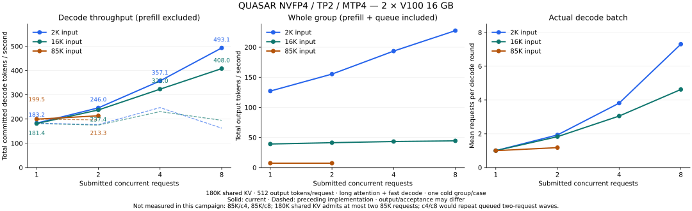

# QUASAR NVFP4 performance

Local hardware: 2 × Tesla V100-SXM2 16 GB, SXM2-to-PCIe adapters, PCIe 3.0 ×16 P2P without NVLink, CUDA 12.8 / SM70. Decode rates count committed tokens, excluding rejected drafts. Context capacity and occupied input length are reported separately. Loading and CUDA Graph priming are outside request timing.

[llama.cpp / LM Studio controls](llama-comparison.md) · [Other V100 profiles](performance-v100.md) · [TP4/NVLink](tp4.md) · [RAM-KV/PP2](experiments.md) · [Inherited upstream campaigns](performance-upstream.md)

## TP2 concurrent packed-batch decode (2026-11-02)

Release **v0.2.1** targets QUASAR NVFP4 v3 / TP2 / optimized-head MTP4 on the
local two 16 GB V100s, with direct PCIe P2P and no NVLink. It uses complete INT8 group-64 KV,
180000 shared KV tokens, chunk 1024, CUDA Graphs, both experimental long-attention/fast-decode
flags, greedy sampling, zero penalties and disabled model stops. Every request independently
consumes the same first 2048, 16384 or 85000 IDs from `v100-code-85000-iommu-pt.ids` and emits
512 tokens. Prefix reuse and historical retention are off. There is no shared-prefix compute
reuse between these cold requests. Loading and a short graph-path warmup are outside timing.

The preceding implementation was frozen before the batch/packet changes and measured on the
same host and workload. These are one cold group per case, not statistical estimates. **Total
decode throughput** counts each compact executor round once: committed tokens excluding each
request's first output divided by summed decode-round wall time, including commit/publication
and excluding prefill and between-round waits. **All-live sampled throughput** instead uses
complete nominal 10 ms sample intervals within all requests' common decode lifetime; its wall
time includes intervening stalls. It is not a timestamped HTTP streaming measurement. **Mean
batch** is request rows divided by decode rounds. Neither metric is the sum of per-request rates.



| Input tokens | Requests | Before decode tok/s | Current decode tok/s | Change | All-live sampled tok/s | Mean batch |
|---:|---:|---:|---:|---:|---:|---:|
| 2048 | 1 | 183.069 | 183.165 | +0.05% | 183.368 | 1.00 |
| 2048 | 2 | 176.987 | 246.020 | +39.00% | 251.398 | 1.93 |
| 2048 | 4 | 247.096 | 357.131 | +44.53% | 369.930 | 3.81 |
| 2048 | 8 | 162.422 | 493.095 | +203.59% | 528.301 | 7.31 |
| 16384 | 1 | 181.326 | 181.355 | +0.02% | 180.493 | 1.00 |
| 16384 | 2 | 174.796 | 237.406 | +35.82% | 247.825 | 1.83 |
| 16384 | 4 | 230.601 | 323.013 | +40.07% | 355.821 | 3.05 |
| 16384 | 8 | 194.733 | 407.952 | +109.49% | 504.014 | 4.62 |
| 85000 | 1 | 199.481 | 199.549 | +0.03% | 199.175 | 1.00 |
| 85000 | 2 | 196.554 | 213.274 | +8.51% | 248.676 | 1.18 |

Single-request differences are at most 0.05%; no single-stream gain is claimed. At 2K, C8
reaches 2.69× C1 in total-round throughput, or 2.88× using the common sampled window. At 16K,
the mean C8 batch is only 4.62 because cold prefill and staggered completion leave fewer than
eight requests decode-ready for much of the group. At 85K the 180K shared KV pool admits only
two full requests. C4/C8 would queue in two-request waves and were not repeated in this
ten-case campaign; the [earlier twelve-case matrix](#experimental-long-context-concurrency-2026-10-20)
retains those wave measurements. The 85K C2 common window is only 1.194 s, so its sampled rate
must not be read as a long steady-state result.

Cold whole-group time at 2K/C8 changes from **34.856 to 17.999 s**, and at 16K/C8 from
**102.955 to 92.265 s**. At 85K/C2 it remains **142.278 vs 142.214 s**: cold prefill dominates,
so the decode gain does not imply a comparable improvement in full-request latency.
[Compact measurements, baseline comparison and equality flags](assets/tp2-concurrency-batch/quasar-concurrency.json)
also retain whole-group rates and acceptance totals.

The retained mechanisms are shared K-major activation supply, shape-selected physical phases
over eight logical K partitions, paired gate/up SwiGLU, and direct TP2 projection publication
into enlarged 640 KiB two-epoch channels followed by sum/RMSNorm. No extra expanded weight
image is kept. The implementation preserves original codes/scales, normal/fast scaling profiles,
BF16 projection/contribution/SwiGLU boundaries and per-request KV/GDN/acceptance ownership.
T<=8 and other TP geometries keep their existing projection paths. See the
[architecture](maintainer/concurrent-inference-architecture.md#10-speculative-decoding) and
[source review](v100-decode-survey.md#tp2-并发源码借鉴2026-11-02); provenance and license notices
are in `NOTICE`.

The final T33..40 paired gate/up tuning keeps cross-phase carry in output-owner registers,
allowing four physical K warps within the 48 KiB shared-memory block limit. Relative to the
preceding packed-batch/packet stage, C8 improves **462.152 → 493.095** at 2K and
**396.428 → 407.952** at 16K, retaining every output ID and draft counter in both cases.
Only these two affected performance cases were repeated; the eight other measurements are
retained from the preceding stage, whose relevant projection dispatch is unchanged.
The compact report identifies each measurement's source stage.

**Numerical limits:** T>32 previously used CUTLASS in some projections; the new batch reduction
has a different association. This also applies to short prefill tails at those shapes, including
a single active request; unchanged measured C1 fixtures do not imply universal bitwise parity.
All measured C1/C2/C4 cases retain every output ID and accepted/
drafted counter of the preceding implementation. Both C8 cases change output IDs and
acceptance, so their entire speedup cannot be attributed to equal-output kernel execution.
Independent FP64 linear/SwiGLU/row-add/norm oracles, read-only inputs/weights, guards and
changing-input Graph checks pass. Real QUASAR C2/C4/C8 normal and long/fast, greedy and mixed
sampling pass complete Graph/eager output/counter and peer-egress checks. These are numerical
and state-transition checks, **not model-quality qualification; no new GPQA was run**.

The [1Cat reference experiment](https://github.com/1CatAI/1Cat-vLLM/blob/HEAD/docs/design/sm70_dflash2_long_batch_20260927.md)
reports about 2.69× C4/C1 and 3.92× C8/C1. That uses four 32 GB V100s, TP4, DFlash2 q7,
FP16/E4M3 KV, 32K inputs, sampling, prefix hits and a client all-live decode window. This
campaign does not run 1Cat locally or establish equal-condition scaling parity.

Reproduce in a fresh SM70 Release build with `NINFER_BUILD_BENCHMARKS=ON`; the benchmark calls
only the public Engine. Use an empty output directory to collect a new campaign:

```bash
cmake --build build-v100-concurrency --target ninfer_v100_concurrency_bench -j4
python3 tools/v100/bench_concurrency.py \
  --binary build-v100-concurrency/bench/ninfer_v100_concurrency_bench \
  --artifact /Models/ninfer-V100X2/quasar-v3/qwen3_8_27b_nvfp4.ninfer \
  --corpus profiles/bench/v100-code-85000-iommu-pt.ids \
  --output profiles/bench/tp2-concurrency-repro \
  --input-tokens 2048 16384 --concurrency 1 2 4 8
python3 tools/v100/bench_concurrency.py \
  --binary build-v100-concurrency/bench/ninfer_v100_concurrency_bench \
  --artifact /Models/ninfer-V100X2/quasar-v3/qwen3_8_27b_nvfp4.ninfer \
  --corpus profiles/bench/v100-code-85000-iommu-pt.ids \
  --output profiles/bench/tp2-concurrency-repro \
  --input-tokens 85000 --concurrency 1 2
```

Full local results and detailed GPU/host health logs are under
`profiles/bench/tp2-concurrency-20261102/`. GPU clocks and limits are unchanged; completed
retained-matrix runs reach at most 56 °C GPU and 63 °C memory, with zero volatile uncorrected
ECC errors reported. This does not establish a hardware performance ceiling.

## v0.1.2: visual long attention and CPU Vision (2026-10-23)

This release adds Vision to the default-off long-attention profile and optionally moves the
visual tower to CPU RAM. It does not introduce a new text decode kernel or claim another
pure-text speedup over v0.1.1. Fast decode remains incompatible with Vision. QUASAR TP4
qualification and measurements ship in v0.2.0; see [TP4](tp4.md).

The qualification below uses the same local two V100s, driver 580.178.04, CUDA 12.8, QUASAR v3,
TP2, MTP4 with optimized proposals, complete INT8 group-64 KV, CUDA Graphs, chunk 1024,
86024-token context/KV capacity, 4096-token visual budget, greedy sampling and no prefix reuse.
Each cold request has exactly **85000 occupied prompt tokens and 129 committed outputs**;
the image case includes a 128x128 red-square image plus repeated text. EOS is ignored up to
the fixed output budget. This is a functional/latency stress fixture, not an answer-quality
evaluation or the older code-task fixture that produced 198.1 tok/s. Each row is one request.

| Tower placement / input | Vision seconds | Prefill seconds | TTFT seconds | Committed wall decode tok/s | Draft accepted / proposed |
|---|---:|---:|---:|---:|---:|
| GPU / image + text | 0.0728 | 68.7531 | 68.8937 | 160.176 | 91 / 146 |
| CPU / image + text | 5.6701 | 68.6886 | 74.4271 | 160.294 | 91 / 146 |
| GPU / text only, Vision enabled | 0 | 68.4658 | 68.5344 | 129.351 | 82 / 177 |
| CPU / text only, Vision enabled | 0 | 68.3060 | 68.3832 | 129.180 | 82 / 177 |

Committed wall decode is `(129 - 1) / (total_seconds - first_token_seconds)`. The text-only
outputs match exactly across tower placement; the measured decode difference is about -0.13%
for CPU placement, not evidence of a new speedup or a general bound. Image outputs differ
between CPU and GPU even though accepted-draft totals agree. CPU visual arithmetic and long
attention can change logits or generated output; no new GPQA or losslessness claim is made.

CPU placement removes **282.02 MiB** of primary-rank GPU weight residency, with no second-rank
tower copy in either mode. The FP32 host tower is about **1.716 GiB**; measured process peak RSS
was 3.732 GiB with CPU Vision versus 1.864 GiB with GPU Vision for the image fixture. These RSS
numbers include loading and scratch, not just the tower, and do not bound historical KV storage.
Program-local immutable visual embeddings have a separate 128 MiB FIFO retention cap.

Independent CPU Op oracles, the real load-placement check and cross-chunk image/prefix/MTP
state checks pass. The native test command is documented in [tests](../tests/README.md#cpu-vision-and-visual-long-attention-012).
Local qualification results and detailed GPU health logs are saved under
`profiles/bench/v0.1.2/`. Power limits and clocks are unchanged. The Linux prebuilt is qualified
separately from a relocated extraction; [requirements and packaging](prebuilt.md).

The relocated package runs with no external `LD_LIBRARY_PATH`: its loaded non-system/non-driver
DSOs resolve inside the extracted package. Real HTTP checks cover red-circle and blue-square
images, repeated-image CPU embedding reuse, mixed text/image concurrency and four-frame video.
During a 5.776-second CPU image encode, an already-running text response produced 287 streamed
deltas over the central 5.276 seconds; its largest observed gap was 19.2 ms. This establishes
continued decode on this workload, not a universal latency bound. A repeated image avoided the
CPU tower (only about 0.14 ms upload time remained).

For a four-frame red-circle-to-blue-square video, CPU and GPU return the same correct answer
when explicitly asked to identify the first and final frames. With the broader video-summary
prompt, both omit one scene (CPU describes the red circle, GPU the blue square). The explicit
probe verifies that both temporal segments are usable; it does not establish general video
description accuracy. CPU visual arithmetic remains an opt-in numerical profile.

## Remote TP4 QUASAR/MTP4 (2026-10-23–24)

The separate four-card NV2 V100 host measures **283.118 / 283.367 committed wall tok/s**
at **85000 occupied input tokens**, mean **283.242 ± 0.176**, with the original
**220 W / 1200 MHz** limits retained. QUASAR v3, 180K capacity, complete INT8 group-64 KV,
chunk 2560, optimized MTP4, CUDA Graphs and both experimental long/fast flags; two cold
requests, 512 timed committed decode tokens each. Prefill averages **2334.73 tok/s**,
first token **36.4077 s**, and the full request **38.2153 s**.

The normal profile, with both experimental flags off, measures **191.997 / 192.210**
wall tok/s (mean **192.104 ± 0.151**), **2327.73 prefill tok/s** and **36.5172 s** first token.
Relative to the preceding paired-QPN stage, long/fast decode improves **22.46%** from 231.302,
and normal decode **16.86%** from 164.392. Prefill improves about **34.2%** from 1743.29.
These are two-request observations on one saved code task, not general speedup guarantees.

Retained mechanisms include 1Cat-inspired large allreduce reduce-scatter/allgather and TP4
Split-D prefill, 64-pack projection publication, fused sum/norm scheduling, five-query K/V
prefetch, the wider FP32 proposal reduction, and a norm output image that preserves explicit
FP32→BF16→FP16 rounding while avoiding a separate cast launch, and single-launch small-T GDN
controls that retain the split-10 arithmetic order. The GDN step improves the preceding
246.431 tok/s norm-image result by 1.78% and passes the independent FP64 control oracle.
TP4 GDN projection/record/conv fusion then improves 250.824 to 258.037 tok/s (+2.88%);
the normal profile improves 178.525 to 182.074 (+1.99%). Its independent decoded-code
FP64 dot/conv oracle respects the public BF16 record boundary without relaxed criteria.
Split-D changes floating-point
association: the saved continuation first differs from the preceding 231 stage at output 505.
The later norm-image, GDN-control and GDN projection/record/conv steps preserve all 513 IDs and MTP counters of the qualified 244.655
stage. Neither statement establishes general output or quality equivalence.
The subsequent TP4-only N64 prefill tile improves prefill by **3.46% / 3.45%** over
N32 in long/fast and normal. It passes the unchanged independent FP64 attention criterion
at the real final 85K chunk. Its saved continuations first differ at zero-based output
**504 / 505** from N32; the long/fast run also changes draft acceptance. Its 0.81% higher
decode rate is therefore not an isolated decode-kernel speedup.
The subsequent ordered split reducer preserves reduction order, while prefetching four
numerators and finishing the shared tree with warp shuffles. Together with an explicitly
typed BF16-rounded FP16 SwiGLU output image, it raises N64's **260.133 / 182.133** to the
intermediate **265.004 / 183.583** (+1.87% / +0.80%). SwiGLU still rounds FP32→BF16→FP16;
down projection reads those represented FP16 values directly. Independent decoded-input
FP64 SwiGLU/down oracles pass without relaxing criteria. Both 85K repetitions retain all
513 output IDs and every speculative counter from their respective N64 profiles.
The GDN gated-norm image then produces **267.487 / 184.815** (+0.94% / +0.67%), with
the same complete IDs/counters. Its N5120/K1536 projection consumes FP16 values after
explicit FP32→BF16→FP16 rounding; independent norm/projection oracles pass unchanged.
Last-CTA GDN record/norm fusion and a caller-owned W8 verifier FP16 input image then
produce **270.694 / 186.204**, preserving explicit state/rounding boundaries and passing
independent FP64 oracles. Direct-peer four-rank argmax advances this to **281.662 / 191.373**
(+4.05% / +2.78%); one origin kernel publishes the exact global tie-broken/mapped winner.
Small I32 broadcasts through 4 KiB then produce **283.242 / 192.104** (+0.56% / +0.38%).
Exact CPU argmax/relocation oracles, changed-input Graphs, immediate source/output reuse
and guards pass. Every later step retains all 513 IDs and all speculative counters.

Four-rank attention, collective, projection/SwiGLU numerical oracles pass. The current normal,
prefix and actual-85K long/fast state gates pass Graph/eager, replay logits/counters and
committed-frontier checks. The earlier uninitialized-scratch residual trial remains removed;
its real-shape regression passes initcheck. No current-combination GPQA was run.
**300 tok/s was not reached; this result is not a measured hardware limit.**

The same host's existing **1cat-vllm 1.5.1**, using the same 85K token IDs, MTP4, output
budget and single-request settings, measures **98.249 / 102.509**, mean **100.379 ± 3.012**
committed wall tok/s. Its first token averages **35.9378 s**, versus NInfer's **36.4077 s**;
its whole request averages **41.0408 s**. It uses FP16/E4M3 KV, versus BF16/INT8 group-64
here; the captured comparison diverges after 325 shared output IDs. These are aligned
workload measurements, not equal-precision or equal-quality results. Its original launcher
uses DFlash2; this control explicitly uses MTP4.
[Implementation, controls, timing and power interpretation](tp4.md#retained-tp4-decode-optimization).

## Six QUASAR/MTP4 decode trials (2026-10-22)

The user requested these six trials without a fixed throughput target. Each uses the public
Engine route on the local two-card PCIe host: QUASAR NVFP4 v3, TP2, **85000 occupied input
tokens**, 180000 capacity, complete INT8 group-64 KV, chunk 2560, greedy optimized-head
**MTP4**, CUDA Graphs and both `--volta-long-attention --volta-fast-decode`. Each cold request
produces 513 outputs; committed wall rate is `512 / (total_seconds - first_token_seconds)`.
Load and Graph priming are outside timing. These are short decode measurements on one saved
code corpus, not a general workload speedup or a new quality evaluation.

The fresh baseline is **196.938 / 197.062 tok/s**. Tail fusion alone measures
**197.062 / 197.318 tok/s**; the roughly 0.10% mean difference does **not** establish an
end-to-end gain. Every other candidate below was measured separately on top of that fusion.
The retained combination adds the smaller GDN record tile and measures **197.614 / 197.698**.
The 2026-10-19 release's 198.105 / 198.097 remains historical evidence, rather than a matched
control for this campaign.

| Direction | Concrete trial | Committed wall tok/s | Decision |
|---|---|---:|---|
| INT8 attention load overlap | Keep next packed K/V tile and scales in registers while processing current QK/PV | 188.754 | Reverted; slower |
| MTP tail fusion | Map shortlist winner inside the TP2 argmax collective, after tie-breaking | 197.062 / 197.318 | Retained; removes launches, speed gain unproven |
| TP2 communication/norm | 128-thread, 128-bit packet polling/loads instead of 512-thread scalar pairs | 193.073 | Reverted; slower and changed output |
| Paired NVFP4 QPN scheduling | Four K partitions / 256 threads instead of eight / 512 | 191.874 | Reverted; slower and changed output |
| GDN verifier value tile | Eight value rows per CTA instead of sixteen, record path only | 197.308 initially; 197.614 / 197.698 repeat | Retained; small observed gain |
| Verified history lookup | Latest matching eight-token suffix supplies four observed draft tokens | 187.220 | Proposal screen rejected; see scope below |

The retained fusion preserves the original score comparison and global shortlist-index tie
policy, then applies the immutable rank-zero token map and publishes the mapped ID to both
ranks. It removes up to four separate remap launches per full MTP4 round. DMA fallback still
composes merge, map and broadcast. Independent exact collective checks cover a nonmonotonic
ID permutation, mapped/unmapped results on both ranks, direct and forced-DMA transport,
infinities, signed zero, ties, changed-input Graph replay, source reuse, map immutability and
guards. The retained run matches all **513 baseline output IDs** and every speculative counter:
123 rounds, 389/490 drafts accepted (79.388%), positions `[119,108,89,73]`, zero fallback.

The smaller GDN tile retains four warps, reduces each warp from four independent value columns
to two, and doubles the record grid's value-axis CTA count. Each column keeps its previous
FP32 transition, warp reduction, BF16 output/record boundaries and immutable source state.
Snapshot and fold keep their previous tile. All three 512-token measurements match the baseline
IDs and counters. A longer paired check of **2048 timed decode tokens** measures **181.580**
for tail fusion alone and **181.880** with the smaller tile, an observed **+0.16%**. All 2049
outputs and counters match: 534 rounds, 1514/2136 drafts accepted (70.880%), positions
`[472,407,343,292]`, zero fallback. The longer continuation's lower acceptance accounts for
its lower rate; it is not comparable to a 512-token measurement as a speedup ratio. These few
sequential measurements support retaining a modest candidate, not statistical significance or
a general speedup claim.

Attention prefetch also matches the 513 baseline IDs and counters. Numerical
checks use the independent attention FP64 oracle and GDN state/record and fold oracles,
respectively. QPN scheduling passes decoded-weight FP64 checks at real TP2 N8704/K5120,
widths 4/5/6 and both numerical profiles; packet vectorization passes collective numerical,
epoch-reuse and Graph checks. Nevertheless, both first differ from baseline at output **130**.
QPN changes K-reduction association; packet norm changes the RMS reduction tree. Passing
operator tolerances does not imply unchanged model output or task accuracy. Neither is shipped.

The lookup trial retains normal target verification and commit/rollback with four drafts.
It finds 14 matches in 129 rounds and accepts only 23 drafts at those matches (1.64 per hit);
overall acceptance falls to 383/514 (74.514%), versus 389/490 for learned MTP. All 513 output
IDs still match baseline. This is a **proposal feasibility screen**: learned next-proposal
computation was still performed, so 187.220 tok/s does not measure a complete implementation
that skips the drafter on hits. Offline causal screens of suffix lengths 4/6/8/12/16 also
show weak continuations on this corpus. This particular proposer is removed; better lookup
selection and skipping drafter work remain candidates, without a claimed negative result for
the whole direction.

All discarded source variants are restored. Local reports, commands, captured output IDs and
detailed GPU/host health logs are under `profiles/bench/quasar-six-20261022/`. Three early
mixed-build pilots were excluded and their QPN/packet/lookup cases rerun with isolated builds.
The final retained CLI, server and benchmark build passes, as do the exact argmax collective,
GDN record and GDN fold tests. The discarded attention-prefetch variant also passes the full
head-local INT8 85K independent FP64 oracle suite, including fragmented, masked and batched
cases. Valid timed runs record GPU temperatures of at most 53 °C;
the longer paired controls reach 50/51 °C GPU and 58/59 °C memory, with no hardware,
thermal or power-brake slowdown recorded in either control.
No new GPQA was run. The retained changes introduce no new reduced-precision profile;
the existing two experimental profiles retain their previously documented numerical caveats.

## Experimental long-context concurrency (2026-10-20)

Long attention admits startup-fixed **1–8 active requests** on SM70 27B TP2
Text/None/MTP. This matrix uses QUASAR NVFP4 v3, MTP4 with optimized proposals,
CUDA Graphs, complete INT8 group-64 KV, 180000 shared KV capacity, chunk 1024,
and both `volta_long_attention` and `volta_fast_decode`. Requests use greedy sampling,
zero presence/frequency penalties and disabled model stop tokens. Each request receives
exactly 2048, 16384 or 85000 tokens from the same saved code corpus and produces
512 output tokens. Prefix reuse and historical retention are disabled for this cold matrix;
there is no sharing of prompt computation between the requests.

Each case is one submitted group, after loading and a short graph-path warmup outside timing.
**Decode throughput** is the sum of committed output tokens excluding each first output,
divided by summed executor decode-round wall time. Each compact round is counted once,
including commit/publication; prefill and time between rounds are excluded. It is not the
sum of per-request rates. **Whole-group throughput** is all output tokens divided by time
from group submission until all results complete, including prefill and queue time.
Mean batch is the number of request rows divided by the number of decode rounds.
These are single measurements, without confidence intervals or a steady-state load claim.


| Input tokens | Submitted requests | Total decode tok/s | Mean batch | Whole-group seconds | Including prefill tok/s |
|---:|---:|---:|---:|---:|---:|
| 2048 | 1 | 177.45 | 1.00 | 4.12 | 124.15 |
| 2048 | 2 | 171.44 | 1.95 | 8.41 | 121.79 |
| 2048 | 4 | 231.97 | 3.83 | 13.70 | 149.50 |
| 2048 | 8 | 159.62 | 7.29 | 35.35 | 115.86 |
| 16384 | 1 | 175.72 | 1.00 | 13.22 | 38.72 |
| 16384 | 2 | 198.02 | 1.79 | 25.71 | 39.82 |
| 16384 | 4 | 252.86 | 2.97 | 49.31 | 41.53 |
| 16384 | 8 | 209.31 | 4.35 | 102.01 | 40.15 |
| 85000 | 1 | 198.32 | 1.00 | 71.33 | 7.18 |
| 85000 | 2 | 193.26 | 1.21 | 142.77 | 7.17 |
| 85000 | 4 | 192.50 | 1.20 | 284.74 | 7.19 |
| 85000 | 8 | 192.95 | 1.20 | 571.62 | 7.17 |

**All 12 cases completed.** At 85K, the 180K shared KV pool admits two full requests at
a time, so c4 and c8 proceed in queued two-request waves. Their mean decode batches remain
near 1.20, while whole-group time scales with the queued waves.

Configured concurrency is an upper bound. Each active request reserves its own full prompt
and output entitlement in the shared KV pool: two 85K requests fit at 180K capacity,
while four or eight execute in queued waves. Even when all requests fit, prefill/decode
interleaving and requests finishing at different times can reduce the mean decode batch.
Increasing concurrency can therefore reduce throughput; it is not a recommended default.

This release extends scheduling and cache ownership, without adding a new single-request
numerical speed profile. The v0.1.0 published 85K reference remains **198.105 / 198.097
committed wall tok/s**, using chunk 2560 and 513 total output tokens. This cold concurrency
matrix uses chunk 1024, 512 total outputs and executor-round timing, so subtracting it from
that reference would not isolate a version improvement. Both experimental switches can
change logits, output IDs or MTP acceptance; this is speed evidence, with **no new GPQA**.

Reproduce with the Python 3.11 maintainer environment and explicit local paths:

```bash
cmake --build build-v100-tp4 --target ninfer_v100_concurrency_bench -j8
.venv/bin/python3 tools/v100/bench_concurrency.py \
  --binary build-v100-tp4/bench/ninfer_v100_concurrency_bench \
  --artifact models/quasar-v3/qwen3_8_27b_nvfp4.ninfer \
  --corpus profiles/bench/v100-code-85000-iommu-pt.ids \
  --output profiles/bench/quasar-concurrency-20261020
.venv/bin/python3 tools/v100/plot_concurrency.py \
  --input profiles/bench/quasar-concurrency-20261020 --output docs/assets
```

The runner saves each completed case and detailed GPU/host health logs, and resumes only
missing cases. [Compact measurements and draft counters](assets/quasar-concurrency.json)
accompany the chart; full local reports retain request-level counts and scheduler samples.

### Decode service during another request's prefill (2026-10-22)

The experimental `--prefill-decode-rounds N` policy gives existing streams up to `N`
decode rounds between prefill steps. Default `1` retains alternation; `4` favors streams
already producing output. This changes scheduling, with the same decode operators and
1024-token prefill chunk. It has no effect on a single active request.

This comparison uses the same QUASAR/TP2/MTP4, INT8 group-64 KV, Graph, greedy,
long-attention and fast-decode settings as the matrix above, with **two cold 85000-token
requests and 2048 outputs each**, 180000 shared capacity, no prefix reuse, and no model
stop tokens. Loading and a short graph-path warmup are outside timing. Each setting has
one measured group. Detailed GPU/host health logs were retained; neither run recorded
hardware thermal slowdown.

| Metric | 1 round | 4 rounds |
|---|---:|---:|
| Existing stream during concurrent prefill, committed wall tok/s | 5.026 | 17.689 |
| Tokens committed during that overlap | 352 | 1336 |
| Overlap wall seconds | 70.038 | 75.527 |
| Existing stream, all time after first token, wall tok/s | 22.894 | 24.044 |
| New request TTFT, including queue time, seconds | 138.193 | 143.944 |
| Whole-group seconds | 159.484 | 160.290 |
| Whole-group output tok/s, including prefill | 25.683 | 25.554 |
| Aggregate decode-round tok/s, excluding prefill | 177.347 | 174.667 |

Overlap wall time includes prefill stalls. It is sampled from public Engine counters while
one request is prefilling and another is decode-ready, at nominal 10 ms intervals (maximum
observed interval 10.32 ms). The all-time stream rate is `(2048 - 1) / (total - TTFT)` from
the Engine's request timings. Both groups completed all 4096 outputs, with 4094 committed
decode tokens after excluding the two first tokens.

Four rounds improved output service during overlap by **3.52×**, and the existing stream's
whole decode interval by about **5.0%**. The new request waited **5.75 seconds longer** for
its first token, and whole-group throughput was about **0.5% lower**. This supports an
optional responsiveness tradeoff, without establishing a single-request or aggregate
throughput improvement. Default remains `1`.

The schedules produce different batch membership over time. Greedy generated IDs differed:
the first differences occurred at output positions 671 and 1513 in the two requests
(one-based). Drafts/accepted drafts were `2117/1517`, `2151/1509` at one round and
`2209/1493`, `2156/1508` at four. This is speed and scheduling evidence, **not a losslessness
or quality result**; no GPQA was run. The existing experimental numerical profiles were
enabled in both cases.

The probe accepts an optional final round count:

```bash
cmake --build build-v100-tp4 --target ninfer_v100_concurrency_bench -j8
LD_LIBRARY_PATH="$PWD/build/_deps/install/lib${LD_LIBRARY_PATH:+:$LD_LIBRARY_PATH}" \
  build-v100-tp4/bench/ninfer_v100_concurrency_bench \
  /Models/ninfer-V100X2/quasar-v3/qwen3_8_27b_nvfp4.ninfer \
  profiles/bench/v100-code-85000-iommu-pt.ids 85000 2 2048 /tmp/scheduling-r4.json 4
```

Local reports and health logs: `profiles/bench/quasar-scheduling-20261022/`.

## QUASAR v3: saved-configuration MTP4 speed matrix (2026-10-19)

The speed-only rerun is complete: **80/80 measured requests**, 40 per saved configuration,
covering the original 36 frozen-token text cases. Native inputs have two repetitions; each
longer length has one. No capability evaluation or GPQA was run. Both saved GUI configurations
use QUASAR v3, TP2, complete INT8 group-64 KV, MTP4, optimized proposal head, chunk 2560
and CUDA Graphs. V keeps Vision resident (1024-token visual budget), has 248000 context
capacity and disables both experimental decode switches. T disables Vision, has 262144
capacity, enables long attention and disables fast decode. **All inputs are text**; this is not
a media speed test. Sampling is greedy, with zero presence/frequency penalties and prefix reuse
disabled, overriding those request settings in the saved configurations.

At 85000 occupied input tokens:

| Task | V committed decode tok/s | T committed decode tok/s | V / T accepted drafts |
|---|---:|---:|---:|
| Story | 86.44 | 103.43 | 32.79% / 30.75% |
| Translation | 143.57 | 179.43 | 71.54% / 71.51% |
| JSONL | 185.04 | 230.40 | 99.06% / 99.06% |
| Logic | 165.22 | 209.63 | 86.15% / 88.36% |

Committed wall decode is `(published_tokens - 1) / (total_seconds - first_token_seconds)`.
Load, graph priming and one full warmup per case are excluded. The profiles differ in several
settings and can produce different output trajectories and lengths; their difference does not
isolate one optimization. Native rows below show means and sample decode standard deviations;
other rows are single measurements. Output counts include the first output and terminating
token. Answers are not graded.

Following the user's interval changes, the first
36 V measurements had no interval, the last four V measurements and first five T measurements
had 30 seconds between requests, and subsequent T requests used no interval below 65536 input
tokens and 30 seconds at 65536/85000, including warmup-to-measurement transitions. Rest is
outside request timing. Air conditioning was enabled by the user. Full recorded GPU temperature
peaks, including earlier attempts, were 62°C (V) and 59°C (T); ECC counters stayed at zero.
Host CPU peaks were 15.4% and 13.6%. The screenshot helper was temporarily disabled with the
user's permission to fit T at its unchanged capacity and restored after completion.

The complete paired tables follow; V/T means the two configurations above.

### Chinese story

| Input tokens | Prefill tok/s V/T | Committed decode tok/s V/T | TTFT seconds V/T | Total seconds V/T | Output tokens V/T |
|---:|---:|---:|---:|---:|---:|
| 129 (native) | 634.35 / 591.93 | 127.84 ± 0.005 / 127.77 ± 0.011 | 0.203 / 0.218 | 8.784 / 8.804 | 1098 / 1098 |
| 1024 | 1676.10 / 1680.74 | 119.17 / 119.08 | 0.611 / 0.610 | 7.803 / 7.807 | 858 / 858 |
| 2048 | 1809.05 / 1816.85 | 118.06 / 117.99 | 1.133 / 1.128 | 10.043 / 10.044 | 1053 / 1053 |
| 4096 | 1801.98 / 1805.77 | 121.57 / 121.60 | 2.274 / 2.269 | 11.010 / 11.003 | 1063 / 1063 |
| 8192 | 1780.12 / 1778.96 | 120.18 / 120.19 | 4.603 / 4.606 | 13.281 / 13.284 | 1044 / 1044 |
| 16384 | 1732.56 / 1732.69 | 119.64 / 122.46 | 9.457 / 9.457 | 18.852 / 17.386 | 1125 / 972 |
| 32768 | 1612.20 / 1621.13 | 107.29 / 118.68 | 20.326 / 20.214 | 30.085 / 30.182 | 1048 / 1184 |
| 65536 | 1417.70 / 1418.18 | 91.35 / 104.14 | 46.228 / 46.213 | 55.916 / 54.883 | 886 / 904 |
| 85000 | 1320.50 / 1314.39 | 86.44 / 103.43 | 64.371 / 64.670 | 77.074 / 73.469 | 1099 / 911 |

### English to Chinese

| Input tokens | Prefill tok/s V/T | Committed decode tok/s V/T | TTFT seconds V/T | Total seconds V/T | Output tokens V/T |
|---:|---:|---:|---:|---:|---:|
| 395 (native) | 1238.56 / 1204.40 | 223.14 ± 0.007 / 222.87 ± 0.032 | 0.319 / 0.328 | 4.572 / 4.586 | 950 / 950 |
| 1024 | 1676.09 / 1680.17 | 223.03 / 222.85 | 0.611 / 0.610 | 5.216 / 5.219 | 1028 / 1028 |
| 2048 | 1811.31 / 1815.54 | 214.27 / 214.17 | 1.131 / 1.129 | 5.766 / 5.765 | 994 / 994 |
| 4096 | 1802.43 / 1805.08 | 215.29 / 215.37 | 2.273 / 2.270 | 6.932 / 6.927 | 1004 / 1004 |
| 8192 | 1772.35 / 1778.17 | 207.87 / 207.90 | 4.623 / 4.608 | 9.058 / 9.042 | 923 / 923 |
| 16384 | 1729.73 / 1727.44 | 197.06 / 206.41 | 9.473 / 9.485 | 13.340 / 13.148 | 763 / 757 |
| 32768 | 1608.48 / 1619.47 | 190.49 / 205.19 | 20.373 / 20.235 | 24.746 / 24.723 | 834 / 922 |
| 65536 | 1413.77 / 1418.43 | 150.96 / 178.96 | 46.357 / 46.205 | 50.974 / 51.010 | 698 / 861 |
| 85000 | 1316.42 / 1314.80 | 143.57 / 179.43 | 64.571 / 64.650 | 69.599 / 69.571 | 723 / 884 |

### 32-record JSONL

| Input tokens | Prefill tok/s V/T | Committed decode tok/s V/T | TTFT seconds V/T | Total seconds V/T | Output tokens V/T |
|---:|---:|---:|---:|---:|---:|
| 118 (native) | 584.06 / 541.08 | 270.70 ± 0.056 / 270.36 ± 0.099 | 0.202 / 0.218 | 4.594 / 4.616 | 1190 / 1190 |
| 1024 | 1674.38 / 1680.20 | 267.47 / 267.17 | 0.612 / 0.610 | 5.057 / 5.060 | 1190 / 1190 |
| 2048 | 1810.47 / 1815.17 | 259.59 / 259.40 | 1.132 / 1.129 | 5.712 / 5.712 | 1190 / 1190 |
| 4096 | 1801.08 / 1805.43 | 259.68 / 259.76 | 2.275 / 2.269 | 6.853 / 6.846 | 1190 / 1190 |
| 8192 | 1770.89 / 1777.93 | 253.56 / 253.56 | 4.627 / 4.608 | 9.316 / 9.298 | 1190 / 1190 |
| 16384 | 1727.61 / 1729.73 | 255.77 / 264.79 | 9.484 / 9.473 | 14.133 / 13.963 | 1190 / 1190 |
| 32768 | 1627.59 / 1619.19 | 232.10 / 247.21 | 20.134 / 20.238 | 25.257 / 25.048 | 1190 / 1190 |
| 65536 | 1407.10 / 1420.03 | 199.40 / 233.07 | 46.576 / 46.153 | 52.539 / 51.254 | 1190 / 1190 |
| 85000 | 1315.78 / 1315.32 | 185.04 / 230.40 | 64.602 / 64.624 | 71.028 / 69.785 | 1190 / 1190 |

### Five-slot logic puzzle

| Input tokens | Prefill tok/s V/T | Committed decode tok/s V/T | TTFT seconds V/T | Total seconds V/T | Output tokens V/T |
|---:|---:|---:|---:|---:|---:|
| 417 (native) | 1279.62 / 1280.58 | 243.83 ± 0.003 / 243.59 ± 0.016 | 0.326 / 0.326 | 5.785 / 5.790 | 1332 / 1332 |
| 1024 | 1674.91 / 1679.78 | 228.26 / 228.01 | 0.612 / 0.610 | 3.525 / 3.527 | 666 / 666 |
| 2048 | 1810.71 / 1814.99 | 241.91 / 241.78 | 1.132 / 1.129 | 3.728 / 3.726 | 629 / 629 |
| 4096 | 1802.08 / 1800.88 | 216.29 / 216.38 | 2.274 / 2.275 | 5.172 / 5.173 | 628 / 628 |
| 8192 | 1769.53 / 1777.39 | 225.69 / 225.66 | 4.630 / 4.610 | 7.275 / 7.255 | 598 / 598 |
| 16384 | 1724.65 / 1733.45 | 227.51 / 237.25 | 9.501 / 9.452 | 12.125 / 12.028 | 598 / 612 |
| 32768 | 1625.98 / 1617.41 | 212.21 / 225.90 | 20.154 / 20.260 | 23.033 / 22.965 | 612 / 612 |
| 65536 | 1402.82 / 1420.65 | 180.77 / 213.03 | 46.719 / 46.133 | 50.547 / 49.376 | 693 / 692 |
| 85000 | 1314.80 / 1314.70 | 165.22 / 209.63 | 64.650 / 64.655 | 68.608 / 67.794 | 655 / 659 |

Saved measurements, frozen configurations, summary and detailed health logs are under
`profiles/bench/quasar-mtp4-speed-20261019/` (`vision.json`, `text-long.json`, `configs.json`,
`summary.json`, `execution.json`, `*-health*/`). The runner resumes only missing saved cases.

## 300-token fully cached TTFT (2026-10-19)

The retained exact-hit schedule publishes the sampled first token before rebuilding MTP
bridge/proposals. A raw-token exact hit also leaves its complete GDN checkpoint in owned RAM
until the first decode consumes it; only the saved tail hidden is needed for output selection.
The lane retains its own anchor, hidden, RoPE and proposal extent across this boundary. A
single-output terminal request can retain the complete RAM image without importing it; a later
suffix or decode restores it before use. Weight arithmetic, sampling, KV values and GDN state
bytes are unchanged. This is a request-phase scheduling change, with no new quality switch.

Measured through public `Engine::generate()` and the first nonempty `OutputSink` delta, on the
hardware above and the saved Text configuration: 262144 capacity, QUASAR TP2, MTP4, INT8 KV,
chunk 2560, CUDA Graphs, long attention on and fast decode off. Actual prompt length is exactly
300, reported reuse is 300 and the computed-prefill delta is zero on every measured request.
Each path has two warmups and 15 timed repetitions, greedy, no penalties, no model-default
stop and 64 output tokens. Preparation, model load, graph priming and checkpoint setup are
outside the streaming interval; HTTP/network/client display latency is not included.

| Cache path | Before median first output | After median first output | Reduction | Before / after range |
|---|---:|---:|---:|---:|
| Raw tokens, RAM checkpoint | 25.963 ms | 1.996 ms | 92.31% | 25.863–26.332 / 1.959–2.039 ms |
| Chat, full-prologue GPU rewrite checkpoint | 5.313 ms | 2.640 ms | 50.31% | 5.251–5.492 / 2.617–2.737 ms |

The separate single-output control measures **0.976 ms (RAM) / 0.985 ms (GPU)** median first
streamed output after the change, again 15 repetitions and full cache hits; there is no measured
single-output before/after ratio. The 64-output request's total time remains approximately
282 ms (RAM) / 262 ms (chat). Work needed for subsequent tokens has moved after first-token
publication; these results do not claim faster prefill or steady-state decode.

All 30 paired cached 64-token outputs and MTP counters match the pre-change build exactly.
Six untimed greedy, single-output terminal and seeded sampled controls (temperature 0.7,
presence 0.4, frequency 0.2, seed 42; both cache paths) also match exactly on token IDs,
MTP counters and captured BF16 logits. These checks support unchanged numerical behavior of
the scheduling change; they are not a new model-quality evaluation. MTP4 Graph/eager prefix
replay, terminal-single-output retention, subsequent suffix restoration, B=2 mixed-sampling
checkpoint isolation and TP2 Vision prefix regression all pass. CLI and serving binaries are
rebuilt. The existing long-attention quality caveat still applies. Evidence and health logs are under
`profiles/bench/quasar-cached-ttft-20261019/` (`baseline-controls.json`, `final.json`, `summary.json`).

## HTTP fully cached first-token latency (2026-10-19)

Measured through the actual `http://127.0.0.1:6198/v1/chat/completions` port with a Python
3.11 standard-library client. The interval begins before sending the request and ends when
the client receives the first **nonempty text delta**, excluding the empty assistant-role
event. Unlike the Engine-only numbers above, it includes connection setup when applicable,
HTTP parsing, prompt preparation and SSE delivery. It does not include a remote network,
reverse proxy or GUI rendering.

The server uses QUASAR TP2/MTP4, optimized proposals, 262144 capacity, complete INT8 group-64
KV, chunk 2560, CUDA Graphs, long attention on, fast decode off and Vision off. Requests are
greedy with zero penalties, exactly 300 prompt tokens, all 300 cached and zero computed prefill,
with 64 output tokens. Both `preserve_thinking` settings were checked. Each of four cases has
two warmups and 15 measurements: **60 measured requests per build**, before and after.
The before/after builds differ only by enabling `TCP_NODELAY` on the HTTP server sockets.

| Chat-history preservation | Connection | Before median first text | After median first text |
|---|---|---:|---:|
| On | Fresh | 6.128 ms | 6.076 ms |
| On | Reused | 44.082 ms | **5.873 ms** |
| Off | Fresh | 6.054 ms | 6.092 ms |
| Off | Reused | 43.758 ms | **5.925 ms** |

The reused-connection reduction is **86.46–86.68%**. The previous server left Nagle enabled;
small SSE frames following the response headers could wait for the peer's delayed ACK.
With `TCP_NODELAY`, the median first SSE event moves from 43.68–44.00 ms to 3.59–3.60 ms,
and the first actual text arrives around 5.9 ms. Fresh connections show no material change.
This removes a transport wait rather than speeding up model computation. All paired visible
outputs, completion/cache usage and speculative counters match exactly.

After the change, median server preparation is about 2.6 ms and server-reported TTFT about
5.3 ms, versus 5.9–6.1 ms at the client. That remaining difference includes HTTP framing,
socket delivery and client parsing, not just wire time. Total 64-output request time remains
about 265 ms. The existing long-attention quality caveat applies; this socket change adds no
numerical approximation. OpenAI Chat/Responses streaming and non-streaming contract checks,
Anthropic non-streaming and fresh/reused Anthropic SSE checks pass on the rebuilt server.

To measure an already-running, idle server with prefix reuse enabled:

```bash
python3 tools/v100/bench_http_ttft.py \
  --base-url http://127.0.0.1:6198 --model qwen3.8-27b \
  --output profiles/bench/http-ttft.json
```

The tool checks the exact expanded token count, full cache usage and repeated greedy text,
consumes each stream completely, and separately records response headers, first SSE event,
first nonempty text and total time. Saved evidence and detailed health logs are under
`profiles/bench/quasar-http-ttft-20261019/` (`baseline.json`, `nodelay.json`, `summary.json`,
`*-requests.jsonl`, `*-health/`, `contract.json`, `messages-stream-check.txt`).

## QUASAR Text / Vision handoff (2026-10-19)

One published QUASAR v3 file serves both startup modes. Text-only loads no Vision GPU objects;
Vision loads its 333 objects (295,711,648 bytes) only on TP2 rank zero. No new checkpoint download
was necessary. With the normal numerical profile and MTP4, the chart CLI check passes at
180000 capacity / 1024 visual tokens (`NIFER VISION 731; 3; left`); the five-second video
passes at 98304 capacity / 4096 visual tokens (`red circle; 3; yes; 9`). These are short media
requests with the stated capacity, not equally occupied contexts or visual-quality benchmarks.

The current QUASAR TP2 prefix integration test passes at 4096 capacity / chunk 1024 / MTP4,
including changed/appended media, stop/resume and the visual-prefix bridge. HTTP checks on
the final build distinguish red/blue inputs when Vision is enabled; disabled startup returns
400 `vision_disabled` for media and still answers text. GUI/TUI persist or expose the startup
switch and independent visual budget; named configurations retain their explicit prefix-reuse setting.
After these checks the replaced `/Models/ninfer-V100X2/qwen3_8_27b_nvfp4.ninfer`
(23,719,715,844 bytes) was deleted. QUASAR and the Q4_K_M artifact remain.

## QUASAR v3: MTP4 retained decode profile (2026-10-19)

The 2026-10-19 retained combination measures **198.105 / 198.097 committed wall tok/s**
in two cold public-Engine requests. Public operator qualification and full85K
MTP4 Graph/eager state qualification pass. The earlier norm-handoff combination measured
180.410 / 180.566 in two requests. These use 85000 actual input tokens, 180000
capacity, complete INT8 group-64 KV, TP2, greedy optimized-head **MTP4**, CUDA Graphs,
a 2560-token prefill chunk and `--volta-long-attention --volta-fast-decode`. Each request produces one
prefill token and 512 timed committed decode tokens. Rate is
`512 / (total_seconds - first_token_seconds)`; model load and graph priming are excluded.
The user stopped that campaign after the final W8 trial. **200 tok/s was not reached**.
The later six-direction trial above has no fixed speed target.

| Retained combination, added in order | Wall tok/s | Output comparison |
|---|---:|---|
| Parent FP32 epilogue + shape-specific streaming | 157.312 (two-request mean) | Same IDs/counters across those repetitions |
| TP2 two-epoch BF16 packet push | 173.803 | Exact 513 IDs and counters to streaming |
| Mixer output packet sum + RMSNorm | 175.006 | Exact 513 IDs and counters to packet |
| MTP shortlist tiled argmax + GDN output activation staging | 178.213 | Exact 513 IDs and counters to packet |
| MLP down sum + next-layer input RMSNorm handoff | **180.410 / 180.566** | Exact 513 IDs and counters to packet |
| Projection epilogue publishes peer packet | 183.201 | Exact 513 IDs and counters to handoff |
| Exact split-10 GDN controls + projection/conv/record fusion | 186.422 | Exact 513 IDs and counters to producer publish |
| Five-query packed KV vector16 loads | 190.124 | Exact 513 IDs and counters |
| Output projection streaming + W8 byte-permute decode | 190.919 | Exact 513 IDs and counters |
| Single-query packed KV vector16 loads | 191.397 | Exact 513 IDs and counters |
| FP32 proposal scores through top-1 | 193.294 / 193.221 | Exact 513 IDs; 122 rounds, 390/486 accepted |
| Fused shard-winner collective | 195.941 / 196.209 | Exact 513 IDs and counters to FP32 proposal |
| MTP hidden/FC buffer reuse | 196.471 / 196.433 | Exact 513 IDs and counters to fused collective |
| MTP stem sum/norm fusion + packed W8 MTP | **198.105 / 198.097** | Exact 513 target IDs; MTP acceptance positions change |

The last step prepackages five QUASAR MTP W8 matrices once at load time, preserving every
code/scale and keeping one resident copy. Width one uses FP32 split GEMV; widths 3..8 use
shape-specific QPN partitions (N5120:16, N7168/N17408:8). The target vocabulary head retains
its earlier accumulation route. The final pair averages 198.101 tok/s, about **+0.84%** versus
the preceding 196.452 pair; these are sequential measurements, not isolated attribution.
All 513 target IDs match, but accepted positions become `[118,108,90,74]` (still 390/486,
122 rounds, zero fallback). Public exact packing/decoded-weight FP64, widths 1/2/3/5/8/9/33,
changed-input Graph, guards and immutability checks pass. Final Graph/eager real-model state
runs agree on 64 IDs/counters and the benchmark prefix, with zero peer-egress mismatches.

`--volta-fast-decode` now explicitly owns the packed NVFP4 FP32 scale-after-K-reduction
profile and the packed MTP W8 arithmetic. It is **off by default**, admitted only for QUASAR
SM70 TP2 Text/None/MTP. The normal route retains per-group FP16 scaling with the same exact packed layout, fusion and communication improvements. The independent
`--volta-long-attention` switch is also off by default. GUI/TUI expose both in their experimental
controls; the ~198.1 result requires the combination, not either switch alone. No independent
on/off speed ratio is claimed. Earlier 25-point target-logit evidence for the numerical combination
has minimum cosine 0.998830814, maximum KL 0.001903103, and 25/25 matching argmax, but only
9/25 points pass the near-lossless bounds. This is not an IQ percentage and does not qualify
current task accuracy. No new GPQA was run. Draft W8 association can additionally change
acceptance; unchanged measured greedy IDs do not prove universal output equivalence.

Before the FP32 proposal change, all rows after the parent epilogue accept 389/490 drafts
(79.388%), with 123 rounds, zero fallback and positions `[118,108,89,74]`. The FP32
proposal route accepts 390/486 (80.247%), with 122 rounds, zero fallback and positions
`[118,107,90,75]`; all 513 output IDs still match. These are
sequential measurements, not an interleaved attribution experiment.

The packet transport adapts the 1Cat/SGLang two-epoch push mechanism to TP2 BF16:
each rank retains its own operand and publishes the remote copy to startup-owned
mailboxes. The fused norm preserves the explicit BF16 sum boundary and the original
local norm association. Fixed 256-pair epoch domains permit mixed fused/unfused
collectives and different widths. The family runtime retains one normalized-input
plane across layer scopes and skips the next layer's duplicate RMSNorm. The first
layer still normalizes its input; the last layer produces no unused handoff.
GDN output N5120/K3072/T1..8 converts BF16 activation to the same FP16 MMA operands
once instead of inside every consumer CTA. The existing exact tiled shard argmax
now covers the MTP 65536-row shard as well as the target head.

The projection epilogue now publishes its BF16 contribution before the consumer
collective runs. GDN controls combine the former ten partials and reduction in one
launch for T2..8, retaining the original FMA and sum order. The GDN input column
epilogue keeps the BF16 projection round and writes convolution/rollback records
directly; its source state remains unchanged. Public tests pass decoded-weight
FP64, exact previous composition, changed-input Graph replay and guards at the
TP2 shapes and both ordinary/QUASAR parent divisors. The current retained combination passes renewed whole-model Graph/eager state qualification.

Public collective tests pass independent FP64, direct/forced-DMA transport, exact
sum/norm composition, changed-input Graph replay, 64-call source reuse and mixed
128-call variable-width chains. Row-add tests pass decoded-weight FP64 at
K3072/8704, T1/5/8/9; shortlist argmax passes exact values/ties and Graph checks.
Real-model Graph/eager runs agree on 64 committed IDs, every speculative counter
and the benchmark prefix; both ranks report zero egress mismatches.

The shard-winner collective merges rank-local scores/indices and publishes the
replicated token IDs in one TP2 P2P kernel, retaining the exact score/tie policy.
Other domains compose UVA gathers, merge and broadcast. Public independent exact
checks cover infinities, signed zero, ties, direct/forced DMA, changed-input Graph
and immediate source/output reuse. Whole-model Graph/eager runs agree on 64
committed IDs and all counters, match the benchmark prefix and report zero peer
egress mismatches.

MTP AR calls now write directly over their dead hidden input, removing separate
next-hidden storage and copy-back nodes. TP2 FC consumes its already contiguous
normalized plane; TP4 still materializes its half-width strided slices. Both full
requests retain all 513 IDs and speculative counters. Renewed full85K Graph/eager
runs agree on 64 committed IDs/counters and the benchmark prefix, with zero peer
egress mismatches.

The proposal Op retains FP32 Q4 draft scores instead of first rounding them to BF16,
avoiding artificial ties. Two full N65536/K5120 FP64 oracle seeds, zero-input ties,
changed-input Graph replay, fallback padding exclusion and immutable-weight/guard
checks pass. This changes proposal choices and acceptance; target-head and target
sampling policy are unchanged. The measured identical output trajectory is not a
universal losslessness claim.

W8 input precast passes the public decoded-weight FP64/composition/Graph suite,
but the full request is 193.207 versus 193.221 tok/s with exact IDs/counters. The
production trial was restored; precast and split tuning remain pending. W8 candidate
rescoring likewise retained the round count and fell to 191.441 tok/s, so that trial
was restored. Attention occupancy, warp-role, split and exact-zero PV skipping
variants have not beaten the retained implementation; these directions remain
open for continued optimization.

**Numerical limits:** QPN5 changes softmax/PV association, and the retained NVFP4
parent epilogue moves scale application after FP32 K reduction. The combined
25-point teacher-forced comparison against default attention matches all argmaxes,
with minimum cosine **0.998831** and maximum KL **0.001903 nats**, but fails the
near-lossless bounds; prefill logits also change. The subsequent transport, staging,
argmax and norm handoff changes introduce no intended new arithmetic change and
preserve the measured output trajectory. That is not a universal quality guarantee.
No new GPQA was run. Long attention remains default-off.

Evidence: `profiles/bench/quasar-180-20261018/summary.json`,
`mtp-reuse-mtp4-long{,-r2}.json`, `mtp-reuse-state-{graph,eager}.json`,
`merge-argmax-mtp4-long{,-r2}.json`, `merge-argmax-public.log`,
`merge-winner-state-{graph,eager}.json`, `proposal-fp32-public-oracle-r2.log`,
`single-vector-mtp4-long.json`, `gdn-exact-glue-mtp4-long.json`,
`layer-norm-handoff-mtp4-long.json`, `handoff-mtp4-long-r2.json` and
`handoff-state-graph-{graph,eager}.json`. The source comparison and remaining
candidates are in [the decoding survey](v100-decode-survey.md).

## QUASAR v3: MTP4 TP2 output reduction (2026-10-18)

Narrow SM70 TP2 NVFP4 row projections now write their contributions into the
existing staging planes and reduce directly into the residual destinations. Rank
0 folds the represented BF16 residual into its projection epilogue, preserving the
previous BF16 projection rounding before the addition. This removes the separate
rank-0 residual-add launch and both post-reduction device copies, with no new
allocation or weight/KV representation. Other widths, formats and TP4 retain their
existing routes.

The workload matches the QPN5 campaign below: QUASAR v3, TP2 on devices 0,1,
85000 actual input tokens, 180000 capacity, complete INT8 group-64 KV, chunk 2560,
greedy optimized-head **MTP4**, CUDA Graphs and optional full-history long attention.
Each cold request has one prefill output and 512 timed committed decode outputs;
loading and graph priming are excluded. Wall rate is
`512 / (total_seconds - first_token_seconds)`.

| Route | Committed wall tok/s | Requests | Accepted / drafted | Rounds / fallback |
|---|---:|---:|---:|---:|
| Previous retained QPN5 profile | 151.505 ± 0.121 | 2 | 388 / 491 | 123 / 1 |
| Direct output reduction + QPN5 | **155.003 ± 0.178** | 2 | 388 / 491 | 123 / 1 |

The new requests measure 155.129 and 154.878 tok/s, a **2.31%** gain over the prior
mean. Both reproduce all 513 prior output IDs and every speculative counter,
including the fallback. At this earlier stage, 180 tok/s was not yet reached.

The public collective suite passes independent FP64 checks with direct P2P and
forced DMA, scalar tails, the 80-KiB transition, wide payloads, unchanged inputs,
guards, and 64 chained source-reuse transitions with Graph replay. The public
NVFP4 row-add suite passes TP2 K=3072/8704 at T=1/5/8/9, direct decoded-weight FP64
comparison, exact comparison with the former composition, guards, immutable
weights/inputs and changed-input Graph replay. Real-model MTP4 Graph/eager runs
agree on 64 output IDs, acceptance counters and the benchmark prefix; both ranks
have 15 egress rounds and zero mismatches.

All 25 teacher-forced full-vocabulary checkpoints of default attention equal the
current pre-change default reference bit-for-bit, including the initial prefill.
This qualifies the represented comparisons, not universal model-quality equivalence.

The optional QPN5 attention arithmetic and its numerical limitations below are
unchanged. No GPQA was run. Results and health logs are in
`profiles/bench/quasar-180-20261018/`; use `outreduce-mtp4-long-r2.json` and
`summary.json`. Reproduce with the command below, `-r 2`,
`--volta-long-attention`, and an explicit new output path.

Subsequent sum/RMSNorm fusion screens were restored. A one-kernel sum/norm and
a two-stage variant preserving the original local/warp reduction association
measured **148.849** and **147.702 committed wall tok/s**, respectively (one cold
85K/MTP4 request each). Both reproduce all 513 retained IDs and every speculative
counter. Public projection FP64, old-composition equality, guards and changed-input
Graph checks pass; the two-stage collective additionally passes direct/DMA,
plain/offset norm, and 64 chained T5 source-reuse transitions with Graph replay.
These trials did not establish an end-to-end gain. A later control using the
unchanged retained binary measured **152.922 / 154.695 tok/s** (153.809 ± 1.254),
also reproducing all IDs and counters. These sequential measurements show time
variation; the complete difference from the historical 155.003 mean cannot be
attributed causally to fusion.
Those pull-based fusion prototypes were removed. The later packet-based fusion above
is a separate retained implementation; further fusion remains a candidate.

A plain NVFP4 input-projection unroll4 trial improved isolated T5 GDN/attention
input times from 46.080/39.936 to 44.032/38.912 microseconds. Public Linear checks
at K5120, N7168/8192, T3/4/5/6/7 passed independent decoded-weight FP64, guards,
unchanged inputs/weights and T5 changed-input Graph replay; outputs also equalled
the old unroll2 route exactly. Whole-request rates were **150.835 / 146.667 tok/s**
(148.751 ± 2.947), with all 513 IDs and counters unchanged. No whole-model benefit
was demonstrated against the later unchanged-binary control above; the original
expansion was restored. This shape-specific direction remains pending. Reports:
`input-unroll4-mtp4-long-r2.json` and `matched-outreduce-mtp4-long-r2.json` in the
same directory. The public numerical screen is `input-unroll-public-fp64-r3.log`.

Explicit NVFP4 operand lookahead was slower at the tested T1/T5 TP2 shapes despite
exact outputs and sampled decoded-weight FP64 checks. Adding packed K/V lookahead
to QPN5 also lost: its 85K partial-plus-reducer time was 276.480 microseconds
without lookahead, 320.512 with one-block/176-register scheduling, and 435.200 with
the spilling two-block/128-register variant. Full-output equality and FP64 checks
pass. A private short-segment FP16 accumulation prototype, after fixing its fragment
unpacking, failed its decoded-weight FP64 criterion and was not introduced.
These are screens of specific variants, not exclusions of their optimization
directions. No GPQA was run.

A separate 64-key QPN5 tile screen passed the same complete-85K decoded-input
FP64 criterion but measured **388.064 microseconds**, against **277.504** for
the retained 32-key tile in the same run. It used 160 registers without spills
and about 71 KiB of shared memory, permitting only one resident CTA per SM.
Outputs were not bit-identical because the softmax grouping and split boundaries
changed. The private prototype was not introduced or tested as a model-quality
improvement. See `qpn5-wider-tile-screen.log`; wider-tile scheduling remains a
candidate for further work.

Further 85K/MTP4 retrieval screens retained complete INT8 codes but changed the
attention read set. Combining a 32768-token RAM window with the long QPN route
measured **149.990 wall tok/s**, accepting 380/527 drafts. A full-GPU-KV prototype
preserved complete prefill and restricted only target decode: a 32768-token global
selection measured **157.203 tok/s**, accepting 381/524; a 16384-token per-layer,
per-rank selection measured **159.852 tok/s**, accepting 380/523. The MTP drafter
kept complete history in both full-GPU trials. These are approximate-attention
results, not complete-history optimizations or quality qualifications. They did
not justify retaining the prototypes; all source changes were restored. A subsequent
unchanged retained-binary control measured **153.684 tok/s**, with the original
513 IDs and counters. No new GPQA was run. Reports use the `ram32k-qpn`,
`decode32k-qpn`, `decode16k-layer-qpn` and `retained-control-after-decode-sparse`
prefixes in the same directory. Retrieval and QPN combinations remain candidates.

## QUASAR v3: MTP4 five-query QPN verifier (2026-10-18)

The optional complete-history `--volta-long-attention` profile now uses a five-query
QPN verifier with distributed Q fragments and inline 32-key online softmax. Four
eight-row QK warps hold 32 Q registers per lane and broadcast their contraction
fragments; eight dimension warps accumulate PV in FP32. Q staging is reused for K/V.
All eight append/cached/masked/batched instantiations use 128 registers with no local
memory. The default attention route keeps the packed-KV lookahead implementation below.

The public Engine workload is unchanged: QUASAR v3, TP2, devices 0,1, 85000 actual
input tokens from `profiles/bench/v100-code-85000-iommu-pt.ids`, 180000 capacity,
complete INT8 group-64 KV, chunk 2560, greedy optimized-head **MTP4**, CUDA Graphs,
no prefix reuse or request warmup, and 512 timed committed outputs plus one prefill
output. Loading and graph priming are excluded. Wall rate is
`512 / (total_seconds - first_token_seconds)`.

| Route | Committed wall tok/s | Cold requests | Accepted / drafted | Rounds / fallback |
|---|---:|---:|---:|---:|
| Default complete history, previous retained build | 128.714 ± 0.049 | 2 | 388 / 491 | 123 / 1 |
| Previous optional long profile | 147.058 | 1 | 386 / 503 | 126 / 0 |
| New optional five-query QPN profile | **151.505 ± 0.121** | 2 | 388 / 491 | 123 / 1 |

The new repetitions are 151.420 and 151.591 tok/s, with identical 513 output IDs
and speculative counters. The approximately 3.02% gain over the previous optional
profile includes a changed output trajectory and fewer rounds; it is not an isolated
kernel speedup. The new output differs at 384 positions from that optional profile
and at one position from the saved default output. These differences do not measure
task quality. A separate 85K fragmented-page kernel experiment improved the
partial-plus-reducer time from 312.320 to 277.504 microseconds (11.15% less time),
under an independent decoded-input FP64 oracle. At this earlier stage, 180 tok/s was not yet reached. Only MTP4 is being optimized in this campaign.

The public attention suite passes complete 85K FP64 comparisons, exact KV codes/scales,
allocation/input guards, T=5 cached and masked cases, and Graph split-boundary replay.
Real-model Graph/eager checks agree on 64 committed outputs, every acceptance counter,
the measured benchmark prefix, and 15 cross-rank egress rounds with zero mismatches.
The full throughput requests each exercise one fallback step.

Twenty-five teacher-forced full-vocabulary checkpoints use a freshly captured current
default reference and the same forced inputs. The initial prefill logits are exact,
and all 25 argmaxes match. Minimum cosine is **0.997987**, maximum KL is **0.007453 nats**,
and maximum reference-argmax deficit is zero. The existing near-lossless bounds
(cosine ≥0.9999, KL ≤0.005, deficit ≤0.25) are **not passed**. This arithmetic profile
remains default-off. No new GPQA evaluation was run; the historical 104-question
results below do not qualify this new profile. The older vocabulary reference was
not reused after its initial prefill failed exact comparison with the current default.

Two additional whole-model screens were not retained as optimizations. Tightening
the MTP graph envelope and splitting the 65536-key transition reproduced all output
IDs/counters but measured 151.389 tok/s, without a gain. Existing approximate RAM-KV
with a 32768-token GPU window measured 136.439 tok/s and 68.93% acceptance on the same
85K/MTP4 workload; it omits unselected history, so it is not recommended for this target.
Both underlying directions remain in the candidate pool.

A TP2 GDN RMSNorm/control fusion was also screened and restored rather than
retained. The initial BF16-control micro passed its private relative-L2 check but
failed the stricter existing public norm/control criterion on a T5 rank. Direct
FP32 normalized controls passed the public FP64 checks for split/parent weights,
T=1/5/8/9/64, guards and changed-input Graph/eager replay. Whole-model MTP4 measured
152.898 tok/s once, with 124 rounds, 388/494 accepted drafts, zero fallback steps
and 384 changed IDs relative to the retained QPN profile, first at position 129.
The approximately 0.92% gain includes that changed trajectory. Graph/eager state
checks passed, but the default-attention vocabulary comparison changed 24/25
checkpoints: argmax 25/25, minimum cosine 0.998454, maximum KL 0.006260 nats.
The long-attention combination was closer to the pre-GDN default on these probes
(minimum cosine 0.999696, maximum KL 0.001792), yet still failed the full bounds.
This does not establish task-quality loss or improvement. The small throughput
gain did not justify changing default control arithmetic without behavioral
evidence; GDN fusion remains a candidate. No GPQA was run. The restored build
reproduced all retained IDs/counters and measured 151.304 tok/s once.

Two exact NVFP4 decode micro variants remain unintroduced: PRMT E2M1 lookup had
no MLP gain, while precomputed FP16 scale operands were slower at the tested
TP2 input/down/MLP shapes. Both passed sampled decoded-weight FP64 checks and
exact comparisons with the previous projection outputs. Selected PRMT/unroll
input shapes improved only at operator scope; no whole-model gain is claimed.

Reports and health logs are in `profiles/bench/quasar-180-20261018/`; `summary.json`
identifies the retained measurement, current vocabulary reference, state checks, and
screens. Reproduce the retained result using the command below with `-r 2`,
`--volta-long-attention`, and an explicit new output path.

## QUASAR v3: packed-KV lookahead (2026-10-18)

In this earlier matched comparison, the SM70 TP2 five-query, eight-warp verifier loads the next 16-key
tile's packed K/V and FP16 scales into registers while computing the current tile.
The original cache codes/scales, split ranges, QK contractions, softmax association,
PV arithmetic and partial-output precision are retained separately for each profile.
The four-query candidate had mixed measurements and was not retained; MTP3 keeps
its existing staging. This change adds no workspace or shared-memory buffer.

Matched public-Engine measurements use the published QUASAR v3 artifact at
`/Models/ninfer-V100X2/quasar-v3/qwen3_8_27b_nvfp4.ninfer`, TP2 on devices 0,1,
85000 actual code-input tokens, 180000 capacity (180032 allocated), complete
INT8 group-64 KV, chunk 2560, greedy optimized-head MTP4 and CUDA Graphs. Each
request has one prefill output and 512 timed committed decode outputs. There is
no prefix reuse or additional request warmup; loading and graph priming are outside
request timing. Default attention has two cold requests per build; the optional
profile has one per build. Wall decode is `512 / (total_seconds - first_token_seconds)`.

| Profile | Before, committed wall tok/s | After, committed wall tok/s | Change | MTP acceptance |
|---|---:|---:|---:|---:|
| Default complete-history MTP4 | 127.037 ± 0.086 | 128.714 ± 0.049 | +1.32% | 79.02% |
| Optional `--volta-long-attention` MTP4 | 143.807 | 147.058 | +2.26% | 76.74% |

The ± values are sample SD across the two default repetitions. The optional row
is a single matched pair, without a variance estimate. Both profiles preserve all
513 output IDs and every speculative counter against their own baseline. Default
requests each have 123 rounds, 491 drafts, 388 accepted drafts and one fallback.
This does not compare the two profiles' trajectories or qualify the optional
profile as a quality-equivalent replacement; its earlier numerical limitations
below still apply.

The public GQA suite passes its independent FP64 attention oracle, including the
new 85000-history, T=5 fragmented-page append/cached cases, exact cache/scale and
input checks, and allocation guards. Its INT8 relative-L2 limit remains 0.00315.
A temporary alternating before/after kernel experiment also checks every partial
BF16 numerator and FP32 softmax maximum/denominator exactly at 32768, 85000 and
131072 history tokens, for default cached/append routes and optional FP32-PV
append attention. At 85K the append partial kernel's throughput improved about
6.9% with default arithmetic and 15.6% with optional FP32 PV; these are operator
measurements, distinct from the whole-request gains above. Exactness describes these represented comparisons,
not a universal model-quality guarantee.

Local reports, commands and health logs are under
`profiles/bench/quasar-focus-20261018/`; `summary.json` compares
`baseline-e2e.json` with `candidate-final-e2e.json`, and
`baseline-long-e2e.json` with `candidate-final-long-e2e.json`.
Use the command in the following section with the corresponding output path;
the default comparison uses `-r 2`, the optional comparison `-r 1`.
Further QUASAR candidates and their external sources are in the
[V100 project survey](v100-decode-survey.md).

## QUASAR v3: final long-context decode evaluation

Measured on 2026-10-13 on two V100-SXM2-16GB cards, CUDA 12.8 / SM70, qualified
PCIe P2P without NVLink. The artifact is `qwen3.8-27b/quasar-nvfp4`; the code input
is the saved `profiles/bench/v100-code-85000-iommu-pt.ids`. Both routes use 85000
actual input tokens, 180000 capacity (180032 allocated), complete INT8 group-64 KV,
chunk 2560, greedy optimized-head MTP4 and CUDA Graphs. Each has two measured cold
requests, no prefix reuse or extra request warmup, one prefill output and 512 timed
committed decode outputs. Loading and graph priming are outside request timing.
Rates are mean ± sample SD; wall decode is `512 / (total_seconds - first_token_seconds)`.

| Route | Prefill tok/s | Committed wall decode tok/s | MTP acceptance |
|---|---:|---:|---:|
| Default complete-history MTP4 | 1313.37 ± 3.89 | 126.894 ± 0.028 | 79.02% |
| `--volta-long-attention` / MTP4 | 1307.41 ± 2.96 | 143.459 ± 0.013 | 76.74% |

| Route | Prepare, s | Prefill, s | First token, s | Decode phase, s | Total request, s |
|---|---:|---:|---:|---:|---:|
| Default | 0.001544 | 64.719 | 64.721 | 4.031 | 68.756 |
| Experimental attention | 0.001593 | 65.014 | 65.016 | 3.566 | 68.585 |

Prepare uses saved IDs, not raw-text tokenizer latency. First-token time includes
prefill; the phase columns are not all additive. Experimental attention improves
decode 13.05% in this pair; prefill variation leaves total request time almost equal.
Both routes repeat all 513 output IDs and speculative counters and match their own
previously qualified controls. Their trajectories differ across profiles. The
requested 150 tok/s was not reached; the user accepted this result and ended that goal.

The retained default optimizations share QK/softmax work across dimension warps,
decode packed INT8 KV cooperatively, stage split-output reduction while retaining
its ascending FP32 association, and precast selected narrow NVFP4 activations.
Paired gate/up warp groups retain FP32 SiLU/product before one BF16 rounding.
The W8 vocabulary head has an exact load-time code/scale permutation, without
requantization or a second resident copy. Its narrow consumers, the W8 MTP
projections and the Q4 proposal head use measured unroll/direct-read paths.
Single-query attention uses eight-row Volta QPN tiles with the default eight-key
softmax and FP16 contribution rounding; five-query attention removes the shared
QK-score handoff while retaining its accumulation associations.

These routes have independent FP64 decoded-weight projection/attention oracles,
exact layout/codec checks, cache/guard checks and CUDA Graph replay evidence.
Twenty-five teacher-forced 85K vocabulary checkpoints of the default attention
changes equal the saved reference exactly. Real-model default and experimental
MTP4 gates separately check 64 graph/eager commits, acceptance counters, partial
commit/fallback and peer egress. Exactness is established for the represented
comparisons, not universal source-model quality.

The optional `--volta-long-attention` flag is startup-fixed and defaults off.
It supports SM70 27B TP2/PP1, one Text/None/MTP request and complete INT8 KV;
Vision, RAM-KV and DFlash are excluded. Above 16390 keys it selects FP32 PV
accumulation for one/five/six-query paths. In this earlier campaign, one/six-query kernels use eight-row
QPN tiles and 32-key online-softmax updates; five-query verification combines
sixteen keys per update. Above 65536 keys those widths target about 1072
keys per split, reducing staging and final-reduction overhead. At 85K the
default has about 355 splits, versus 80 in the experimental profile. Every
causally visible historical KV entry remains included. Wide prefill is unchanged.

Full 85K attention passes the independent FP64 relative-L2 criterion of 0.00315,
with exact packed cache bytes and graph/eager boundary checks. However, the
experimental MTP4 profile fails the separate near-lossless full-vocabulary gate:
25/25 argmax matches, minimum cosine 0.998905, maximum KL 0.007842 nats, against
bounds of cosine ≥0.9999 and KL ≤0.005. More FP32 accumulation and changed
partition/softmax association do not imply bit identity or task-level equivalence.
This is why the profile remains opt-in.

Final local reports are `profiles/bench/quasar-150-tp2/final-20261013-mtp4-{default,long}.json`.
Reproduce either route with the public benchmark; add `--volta-long-attention`
for the experimental row:

```bash
LD_LIBRARY_PATH="$PWD/build/_deps/install/lib:/usr/local/cuda-12.8/lib64" \
  build-v100-tp4/bench/ninfer_bench \
  --weights /Models/ninfer-V100X2/quasar-v3/qwen3_8_27b_nvfp4.ninfer \
  --tp 2 --devices 0,1 --max-ctx 180000 --kv-dtype int8 --prefill-chunk 2560 \
  --spec mtp --draft-tokens 4 --lm-head-draft \
  --corpus profiles/bench/v100-code-85000-iommu-pt.ids \
  -pg 85000,512 --warmup 0 -r 2 --capture-generation -o json \
  --output-file profiles/bench/quasar-final-default.json
```

### Local GPQA-Diamond comparison: 104 paired questions

This is an **85K unrelated-code occupancy variant**, not standard short-context
GPQA-Diamond. A frozen data-independent shuffled order and identical question/
answer-choice prompts are shared by all four routes. Each input occupies 85000
tokens; capacity is 131072, output budget 32768, chunk 2560, greedy MTP4,
`reasoning_effort=xhigh`, complete INT8 KV and no prefix reuse. Embedded frontend
resources match across artifacts. Scoring uses the final `ANSWER: A/B/C/D`;
missing or truncated answers count as incorrect in the full score.

| Local artifact / profile | Correct / 104 | Accuracy | Output-budget truncations |
|---|---:|---:|---:|
| QUASAR, default attention | 88 | 84.62% | 11 |
| QUASAR, experimental attention | 90 | 86.54% | 8 |
| Official NVFP4 | 90 | 86.54% | 5 |
| GGUF-derived Q4_K_M | 87 | 83.65% | 5 |

Default → experimental has two losses and four gains, +1.92 percentage points;
paired McNemar exact two-sided p=0.6875. There is no detected accuracy decrease
in this sample, but no statistical noninferiority or universal quality-equivalence
claim follows. Truncation affects the score; no BF16/FP8 local reference was run.
The user accepted this comparison and stopped at 104 common questions. The
remaining 94 questions were not run; this is not a completed 198-question score.

Runner: `tools/v100/bench_gpqa.py` and the public-Engine `ninfer_v100_gpqa` target.
Saved local results: `profiles/bench/gpqa-85k-matrix/{default,long,nvfp4,q4,summary}.json`.
The summary preserves `complete=false`.

### Original short JSONL DFlash7 retest

The 2026-10-13 retest uses the original **32-record arithmetic JSONL generation**
case that measured 249.00 tok/s, not the demo-page JSON→JSONL conversion prompt.
Input is 118 tokens; capacity 98304, chunk 1024, complete INT8 group-64 KV,
greedy full-head DFlash7, CUDA Graphs, no prefix reuse and model-default stopping.
One full warmup precedes two measured requests.

| Measurement | Prefill tok/s | Committed wall decode tok/s | Acceptance |
|---|---:|---:|---:|
| Original 2026-10-03 | 564.22 ± 0.33 | 249.00 ± 0.08 | 99.05% |
| Final 2026-10-13 | 580.95 ± 0.01 | 255.31 ± 0.11 | 99.05% |

Each final answer publishes 1190 tokens, with 1189 timed after the first, and
stops naturally. All 32 record values, arithmetic and field order pass exact
checks. All output IDs and speculative counters equal the original measurement.
Committed throughput is 2.53% higher; **300 tok/s was not reached**. This is
high-acceptance structured generation, not a general code/prose speed claim.
The experimental attention flag is off and unsupported for DFlash.
Report: `profiles/bench/quasar-150-tp2/final-20261013-jsonl-native-dflash7.json`;
reproduce with `ninfer_v100_task_bench`, task `structured_jsonl`, occupancy `native`
and the existing `profiles/bench/other_inputs_20261001/cases.json`.
Detailed health logs accompany all three final cases: no reset, zero volatile
uncorrected ECC, maximum observed GPU temperature 64°C and host CPU use below 37%.
This short run does not establish long-duration hardware stability.

Release checks rebuild the CLI, server and affected benchmarks; artifact, CLI/server
option and report-contract tests pass. GPQA scoring tests and schema-v15 matrix
consumption pass, including both saved final reports. Current 85K MTP4 graph/eager
state checks pass with identical commit IDs/counters and zero peer-egress mismatches.
A broader public FP64 attention rerun was stopped by its wrapper's 560-second
timeout while computing the six-query reference, without a numerical failure being
reported; no completed verdict is claimed for that rerun. The affected five-query
operator and full-vocabulary comparisons above retain their completed evidence.

## QUASAR v3: Volta QPN projections

The separate `qwen3.8-27b/quasar-nvfp4` trial uses the published QUASAR NInfer v3 artifact
on this two-card PCIe-P2P host, without NVLink. QUASAR is QAT, not mathematically lossless
compression. Its stored NVFP4 codes/scales and FP32 activation divisors remain unchanged;
this does not establish BF16-equivalent artifact quality. The profile is text-only and loads
zero Vision objects onto either GPU; validation-only Vision data remains in the original file.

SM70 Attention/GDN input and output projections now share the load-time QPN layout with MLP.
Narrow inputs write final output planes directly. Wide projections decode weights once per
call for CUTLASS and distribute the BF16 result. There is no second resident weight copy,
A4 activation quantization or attention-history pruning. Independent FP64 input-projection
oracles cover real TP1/TP2 geometries and QPN/CUTLASS boundaries. Public Engine MTP and DFlash
gates each pass 64 strict teacher-forced positions and graph/eager sampling checks.

Measured on 2026-10-03: two V100-SXM2 16 GB, 300 W/card, CUDA 12.8 / SM70, saved code inputs,
chunk 2560, complete INT8 group-64 KV, greedy optimized-head MTP3, CUDA Graphs and no prefix
reuse. Two measured requests per row; 3072-input rows have no extra warmup, and 85000 input
follows one complete warmup. Each generates one prefill output and 512 timed committed decode
outputs. Load and graph priming are outside timing. Decode is committed output divided by
wall time after the first token; rates are mean ± sample standard deviation.

| Route | Actual input / capacity | Prefill tok/s | Committed wall decode tok/s | Acceptance |
|---|---:|---:|---:|---:|
| Before QPN input integration | 3072 / 8192 | 376.71 ± 0.77 | 102.02 ± 0.06 | 85.78% |
| QPN / MTP3 | 3072 / 8192 | 1751.55 ± 30.90 | 139.80 ± 0.08 | 85.19% |
| QPN / MTP3, warmed | 85000 / 180000 | 1315.28 ± 2.61 | 100.34 ± 0.05 | 86.62% |

The matched short-input gain is 4.65× prefill / 1.37× decode. Warmed 85K mean prefill,
decode phase and total request times are 64.625 / 5.100 / 69.729 seconds; the decode-phase
rate is 100.40 tok/s. MTP weights occupy 8.66 GiB per card. Within each route, repetitions
reproduce all output IDs and speculative counters. Before/after short-input trajectories
first differ at output position 270; numerical qualification does not prove unchanged
end-to-end quality. No BF16 quality score or full-180K/256K occupied-context result is claimed.
Reports: `profiles/bench/quasar-qpn-projections/{before-mtp3,after-mtp3,after-85k-mtp3-warm}.json`.

## QUASAR v3: stop-aware task matrix

Measured on 2026-10-03 through the public Engine using the same frozen token IDs as the
official-v3 non-code sweep below. Four tasks cover a three-chapter Chinese story requesting
900–1200 Chinese characters and fixed literal items; six-section English-to-Chinese translation
with at least 20 glossary entries; exactly 32 prescribed JSONL records; and a five-slot logic
puzzle with a complete service/colour/port mapping and final `CHECK=4606`.

Both backends use TP2 devices 0,1, **98304 context/KV capacity**, chunk 1024, complete INT8
group-64 KV, greedy CUDA Graphs, zero presence/frequency penalties, disabled thinking/prefix
reuse and zero Vision GPU objects. MTP uses three drafts and the optimized proposal head;
DFlash uses seven drafts and the full proposal head. Every case has one full warmup; native
inputs have two measured repetitions per backend, all other points only one. All 80 measured
requests stop naturally at their first model end token before the 2048-output budget. Load,
graph priming, warmup and cooldown are excluded. Committed wall decode is
`(published_tokens - 1) / (total_seconds - first_token_seconds)`; phase decode is retained
separately in the report. Counts include the prefill output and terminating model token.

The actual input counts are 129 / 395 / 118 / 417 for native story / translation / JSONL /
logic, then exactly 1024 / 2048 / 4096 / 8192 / 16384 / 32768 / 65536 / 85000 for each task.
Distinct technical-document backgrounds precede the unchanged final task/template. Visible
background varies with length, so this is not a single-variable length or retrieval-quality
experiment. **D/M means DFlash7 / MTP3** in every paired table. Native decode shows mean ±
sample standard deviation; other entries are single measurements, not stable means.

### Chinese story

| Actual input tokens | Prefill tok/s D/M | Committed wall decode tok/s D/M | Acceptance D/M | Total output tokens D/M | Identical IDs |
|---:|---:|---:|---:|---:|:---:|
| 129 (native) | 631.17 / 632.74 | 56.45 ± 0.002 / 89.58 ± 0.007 | 11.43% / 39.80% | 990 / 1152 | No |
| 1024 | 1587.24 / 1676.19 | 59.98 / 89.34 | 13.73% / 40.11% | 1202 / 1202 | Yes |
| 2048 | 1588.60 / 1679.56 | 58.38 / 85.06 | 13.80% / 37.80% | 1034 / 1034 | Yes |
| 4096 | 1576.10 / 1666.56 | 53.75 / 83.76 | 11.42% / 36.47% | 934 / 934 | Yes |
| 8192 | 1548.49 / 1638.20 | 55.62 / 82.65 | 12.90% / 37.00% | 940 / 940 | Yes |
| 16384 | 1500.94 / 1583.26 | 58.74 / 85.15 | 15.47% / 41.59% | 952 / 952 | Yes |
| 32768 | 1415.61 / 1481.05 | 48.32 / 77.06 | 13.08% / 40.12% | 726 / 726 | Yes |
| 65536 | 1257.29 / 1322.89 | 41.32 / 64.82 | 13.72% / 38.96% | 796 / 796 | Yes |
| 85000 | 1176.69 / 1226.43 | 39.26 / 61.28 | 14.63% / 39.70% | 1077 / 1077 | Yes |

### English → Chinese translation

| Actual input tokens | Prefill tok/s D/M | Committed wall decode tok/s D/M | Acceptance D/M | Total output tokens D/M | Identical IDs |
|---:|---:|---:|---:|---:|:---:|
| 395 (native) | 1201.31 / 1238.48 | 162.90 ± 0.021 / 143.66 ± 0.044 | 60.36% / 83.74% | 998 / 858 | No |
| 1024 | 1587.78 / 1682.12 | 154.45 / 143.26 | 57.56% / 84.42% | 1027 / 1027 | Yes |
| 2048 | 1581.97 / 1678.69 | 149.46 / 140.75 | 57.28% / 84.32% | 1012 / 1012 | Yes |
| 4096 | 1570.32 / 1665.85 | 144.89 / 138.87 | 55.06% / 82.24% | 899 / 899 | Yes |
| 8192 | 1545.72 / 1637.66 | 145.07 / 139.49 | 56.61% / 85.52% | 924 / 975 | No |
| 16384 | 1505.51 / 1582.73 | 124.65 / 129.88 | 48.96% / 80.69% | 757 / 757 | Yes |
| 32768 | 1413.89 / 1480.07 | 124.26 / 124.26 | 56.03% / 85.08% | 882 / 882 | Yes |
| 65536 | 1264.06 / 1322.04 | 98.82 / 102.86 | 52.81% / 81.32% | 883 / 883 | Yes |
| 85000 | 1184.80 / 1232.95 | 87.06 / 93.29 | 49.87% / 78.03% | 723 / 723 | Yes |

### 32-record JSONL

| Actual input tokens | Prefill tok/s D/M | Committed wall decode tok/s D/M | Acceptance D/M | Total output tokens D/M | Identical IDs |
|---:|---:|---:|---:|---:|:---:|
| 118 (native) | 563.48 / 567.46 | 247.73 ± 0.134 / 163.33 ± 0.032 | 99.05% / 99.89% | 1190 / 1190 | Yes |
| 1024 | 1588.03 / 1680.68 | 242.15 / 161.98 | 99.05% / 100.00% | 1190 / 1190 | Yes |
| 2048 | 1581.29 / 1679.06 | 232.84 / 158.92 | 98.30% / 99.78% | 1190 / 1190 | Yes |
| 4096 | 1574.58 / 1665.46 | 234.86 / 158.91 | 99.05% / 100.00% | 1190 / 1190 | Yes |
| 8192 | 1549.08 / 1635.96 | 229.81 / 156.56 | 98.30% / 99.78% | 1190 / 1190 | Yes |
| 16384 | 1504.45 / 1581.44 | 221.85 / 151.38 | 98.30% / 99.89% | 1190 / 1190 | Yes |
| 32768 | 1413.90 / 1472.01 | 198.65 / 139.45 | 98.30% / 99.78% | 1190 / 1190 | Yes |
| 65536 | 1261.11 / 1318.70 | 165.74 / 119.52 | 98.30% / 99.78% | 1190 / 1190 | Yes |
| 85000 | 1180.44 / 1227.40 | 152.72 / 111.73 | 98.30% / 99.78% | 1190 / 1190 | Yes |

### Five-slot logic puzzle

| Actual input tokens | Prefill tok/s D/M | Committed wall decode tok/s D/M | Acceptance D/M | Total output tokens D/M | Identical IDs |
|---:|---:|---:|---:|---:|:---:|
| 417 (native) | 1240.28 / 1283.12 | 204.68 ± 0.034 / 152.93 ± 0.042 | 80.06% / 91.83% | 1301 / 1301 | Yes |
| 1024 | 1594.90 / 1681.08 | 185.00 / 143.35 | 71.69% / 84.41% | 656 / 656 | Yes |
| 2048 | 1581.55 / 1678.54 | 193.55 / 151.54 | 78.17% / 92.79% | 699 / 699 | Yes |
| 4096 | 1569.54 / 1664.90 | 151.70 / 137.03 | 58.27% / 81.33% | 514 / 514 | Yes |
| 8192 | 1547.80 / 1636.89 | 195.49 / 143.77 | 81.29% / 89.14% | 670 / 642 | No |
| 16384 | 1502.74 / 1580.28 | 177.22 / 139.75 | 75.55% / 89.77% | 699 / 697 | No |
| 32768 | 1412.87 / 1476.17 | 162.39 / 132.71 | 77.59% / 93.58% | 612 / 612 | Yes |
| 65536 | 1258.20 / 1316.37 | 135.01 / 112.12 | 77.25% / 91.89% | 693 / 693 | Yes |
| 85000 | 1186.82 / 1238.87 | 127.43 / 105.94 | 79.14% / 93.06% | 655 / 655 | Yes |

### Complete requests and output qualifications

| Task at 85000 input tokens | Prefill seconds D/M | Decode wall seconds D/M | Total resident request seconds D/M |
|---|---:|---:|---:|
| Chinese story | 72.237 / 69.307 | 27.404 / 17.560 | 99.642 / 86.868 |
| English → Chinese translation | 71.742 / 68.940 | 8.293 / 7.740 | 80.036 / 76.681 |
| 32-record JSONL | 72.007 / 69.252 | 7.786 / 10.642 | 79.794 / 79.895 |
| Five-slot logic puzzle | 71.620 / 68.611 | 5.132 / 6.173 | 76.754 / 74.785 |

At 85K, DFlash improves JSONL/logic decode by 36.69% / 20.28%, with identical complete output
IDs; story/translation decode is slower. DFlash prefill is slower throughout the matrix.
JSONL total request time differs by only 0.101 seconds (about 0.13%), within what a single
pair can establish; this is not claimed as a stable whole-request gain. Logic is slower
overall despite faster decode. The 247.73 tok/s native JSONL rate is high-acceptance structured
generation, not ordinary translation, general code or a 12K-input JSONL translation speed.

All ten JSONL completions per backend pass exact count/value/arithmetic/field-order checks.
All ten logic answers per backend contain the complete expected mapping and `CHECK=4606`,
including separate assignment lists and combined mappings. Translations retain six headings
and at least twenty glossary entries; this is not an independent translation-accuracy score.
All stories retain the three chapter headings and required literal items, but only 8K, 16K
and 64K satisfy the 900–1200 Chinese-character bound. The 85K story contains 1228 Chinese
characters in both routes. Native repetitions reproduce output IDs and speculative counters
within each backend. Only 31 of 36 task/length pairs match complete IDs: native story/translation,
8K translation/logic and 16K logic differ. All 85K pairs and every JSONL pair match. No universal
token parity, artifact-quality score or quality-losslessness claim follows from these checks.

MTP reserves 8.66 GiB weights per card, DFlash 10.36 GiB. At this capacity the reported per-card
KV/workspace reservations are 1.64/0.74 GiB for MTP and 1.625/0.727 GiB for DFlash; these
figures are GPU arenas, not process RSS or aggregate two-card memory.

Reports and corpus remain local under `profiles/bench/quasar-qpn-projections/{all-mtp3,
all-dflash7,matrix-summary}.json` and `profiles/bench/other_inputs_20261001/cases.json`.
The read-only health logs preserve 200 ms GPU samples, per-second host/process/thread and Engine
progress, request/phase/cooldown timestamps, device/host health counters and kernel events with
synced writes.
No power limits, clocks or system settings were changed. Reproduction uses the public
[`ninfer_v100_task_bench`](../bench/README.md#stop-aware-v100-task-probes); raw outputs, telemetry,
model files and the local filming demo are not committed.
